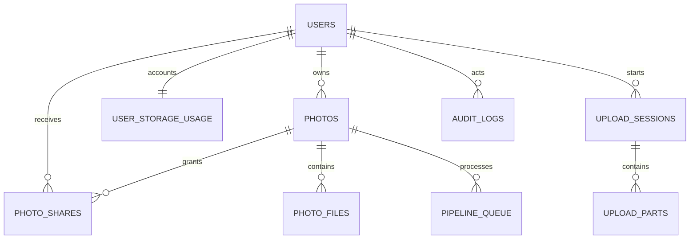
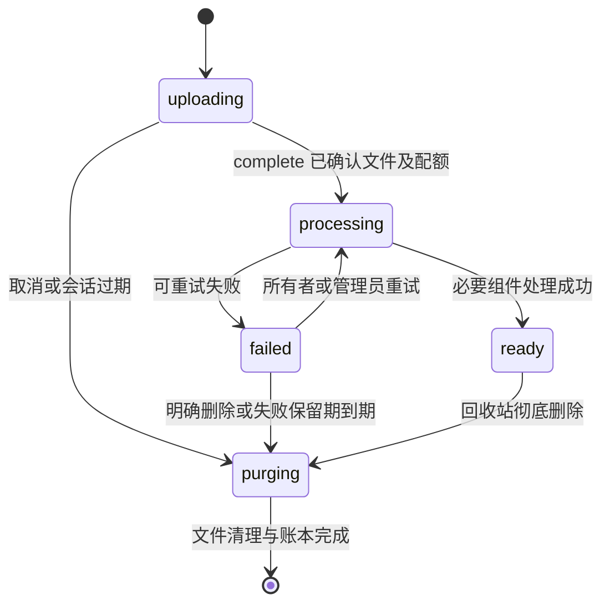

# Chronoval 多用户、个人上传、照片与相册访问权限开发设计

版本：1.2 · 日期：2026-10-31 · 状态：已按本文开展实现；实际交付和验证范围见 [实施记录](./multi-user-implementation-20261101.md)。本文保留目标设计及部署验收要求。

代码基线：服务器 `/home/liuwb/test/Chronoval-liuwb/Chronoval`，分支 `liuwb-fix-chonggou`，提交 `2ee206e`。

本文交付完整的产品行为、目标数据库结构、权限规则、接口、页面和开发验收要求。用户已明确允许删除数据库重建，因此不设计旧数据迁移、旧表兼容、双写或旧接口长期过渡。数据库重建不等于删除 NAS 原照片；扫描目录原文件必须保留。

本版按最新确认的规则修订：仅管理员手动创建用户；用户名/邮箱均可配合密码登录；个人原文件保存在 `photos/{username}/` 并保持上传文件名和内容；所有权转移必须真实搬动原文件和派生文件、撤销旧授权，并让新所有者接管。本文后续各章均按这些规则执行，不保留只改数据库归属的转移方式。

本次进一步明确：用户所说的“任务相册”指**人物相册**。自建相册、映射/扫描目录相册、站点人物相册必须使用同一套可见范围、指定用户、密码策略、服务端授权与验收矩阵；不得再出现映射相册只有“隐藏”、自建相册才有完整权限的差异。下文“相册”和“相簿”均指 collection。

## 1. 目标、边界与关键决策

实现以下能力：管理员创建普通用户；普通用户登录并上传自己的照片；照片支持公开、仅自己、指定用户三种可见范围；管理员可以查看和管理所有用户的照片及其权限。

### 1.1 本期必须交付

1. 管理员创建、编辑、禁用、恢复用户，重置密码，设置上传开关和空间配额。
2. 用户个人空间：我的照片、上传、我分享的、分享给我的、回收站、账号安全。
3. 照片所有者和上传者的独立记录；个人照片与站点扫描图库的明确边界。
4. 每张照片的可见范围、指定接收者、撤销共享、批量权限修改。
5. 服务端可靠的上传会话、唯一照片身份和受控原名存储、配额预留、后台处理和失败清理。
6. 所有展示入口、原图、缩略图、视频、动态照片、下载、搜索、地图和人物的统一鉴权；用户名或邮箱加密码登录。
7. 管理员全站照片管理、权限调整、归属转移、操作审计。
8. 删除、禁用、重置密码、撤销共享后，新请求立即按照新状态执行。
9. 保留现有站点相簿、扫描库、离线地图、动态照片和纯字母数字媒体地址能力。
10. 自建、映射目录、人物相册统一支持所有人可见、登录后所有人可见、指定用户可见、仅管理员可见；父目录限制、照片自身权限、相册密码相互独立并共同生效。

### 1.2 本期不做

公开自助注册、邮箱服务、链接匿名分享、家庭群组、组织和团队、共同编辑权限、自定义角色、普通用户写入扫描目录、普通用户创建站点相簿、跨用户文件物理去重、跨账号人脸识别、远程第三方登录扩展。

指定用户共享只授予查看和下载权限，不授予编辑、删除、再次授权或所有权。接收者可以自行保存已下载内容；撤销共享不能收回此前已经下载的文件。

### 1.3 产品决策

| 事项 | 采用的规则 |
| --- | --- |
| 普通账号创建 | 仅管理员创建，不开放注册 |
| 登录账号 | 用户名或邮箱，使用同一密码和 2FA |
| 用户名 | 全站不区分大小写唯一，创建后固定；显示昵称可改 |
| 角色 | `admin`、`user`；操作照片还必须检查所有权 |
| 普通用户上传目标 | 默认存储的 `photos/{username}/`，由服务端分配并验证路径 |
| 原文件保存 | 原始名称、格式和字节内容保留；冲突进入独立目录，不覆盖、不自动改名 |
| 个人照片默认权限 | `private`，即仅所有者及管理员 |
| 公开 | 匿名访客也可访问，仍受全局安全状态和站点集合限制 |
| 指定用户 | 仅所有者、有效授权接收者、管理员；其他已登录用户无权访问 |
| 相册可见范围 | 三类站点相册统一为 public/login/selected/admin，指定名单与密码免密名单分别保存 |
| 映射目录继承 | 祖先目录限制逐层取交集；子目录和其他相册不能扩大已生效限制 |
| 管理员 | 可以查看、修改、删除及调整所有照片权限；敏感操作记审计 |
| 所有权转移 | 管理员发起持久化搬运任务；搬到新用户名目录，强制 private、清空旧共享，新用户拥有管理权 |
| 暂停账号 | 立即禁止登录和新操作，该账号个人照片对其他普通用户和访客隐藏 |
| 删除账号 | 先禁用，再按“转移照片”或“删除照片”明确处理，禁止直接级联删除文件 |
| 历史数据库 | 允许重建，直接实现目标结构 |
| 部署 | 本文不执行删库、构建镜像或部署 |

“仅自己可见”不是端到端加密。页面必须明确提示：**系统管理员仍可以查看和管理**，避免与本需求中的管理员能力冲突。

### 1.4 采用成熟设计的方式

采用角色、资源所有者和显式共享关系共同判断权限，而不是只判断是否登录。默认拒绝，并对每次资源请求检查权限。这遵循 OWASP 授权建议 [R1]。

用户创建、密码重置、按用户配额和共享查看者的产品组织参考 Immich 的官方设计 [R3][R4]。本文按 Chronoval 的现有结构收敛范围，不照搬其完整架构，不新增 Redis、PostgreSQL、消息中间件或外网依赖。

## 2. 现有代码与实际存储事实

下表路径均相对于上述仓库根目录，是开发者必须先阅读的现有实现。

| 文件 | 当前职责 | 本期处理 |
| --- | --- | --- |
| `server/database/schema.ts` | 用户、照片、集合、授权、队列表 | 按本文目标结构直接调整并生成全新建库基线 |
| `server/utils/access-policy.ts` | 路由公开、用户、管理员分级 | 精确登记新路由，保持未登记接口默认管理员 |
| `server/utils/access.ts` | 从数据库恢复当前用户身份 | 增加账号状态、会话版本及强制改密检查 |
| `server/utils/photo-visibility.ts` | 集合授权和照片列表过滤 | 增加个人照片 ACL 和查询上下文 |
| `server/utils/photo-access.ts` | 单照片访问、可见 ID | 统一读与管理能力，不允许各接口自行放宽 |
| `server/utils/media-access.ts` | 文件映射回照片后鉴权 | 基于 `photo_files` 鉴权，覆盖所有媒体入口 |
| `server/utils/asset-reference.ts` | 编码照片 ID 为无文件名视频地址 | 新资源改为随机文件 ID，不再从地址解码照片 ID |
| `server/api/photos/index.post.ts` | 按文件名准备上传地址 | 用受控上传会话替代个人上传逻辑 |
| `server/api/photos/upload.put.ts` | 接收原始文件并写入存储 | 改为会话绑定上传，禁止客户端指定任意存储键 |
| `server/api/photos/library-upload.put.ts` | 向扫描目录写文件 | 继续仅管理员，不能为普通上传放开 |
| `server/services/pipeline-queue/manager.ts` | 缩略图、EXIF、入库及 ML 派发 | 使用预分配照片 ID、会话 ID 和固定存储，不再从文件名推算 ID |
| `server/services/image/processor.ts` | HEIC/RAW 预览转换 | 所有派生文件使用服务端分配的同一照片目录 |
| `server/services/library/scanner.ts` | 扫描目录建索引 | 继续生成站点资源，不能扫描进个人上传目录 |
| `server/services/trash/cleanup.ts` | 软删除后的彻底删除 | 按文件登记逐个清理，成功后才释放空间与完成清除 |
| `server/services/ml/*` | 搜索、OCR、人脸、人物 | 读结果统一过滤，人脸聚类按所有者分区 |
| `app/pages/dashboard/photos.vue` | 当前管理员上传与管理界面 | 提取可复用组件，个人空间调用独立受控接口 |
| `app/middleware/admin.global.ts` | 阻止普通用户进入后台 | 保留，新增个人空间的用户守卫 |
| `app/components/AlbumEditSlideover.vue` | 自建与映射相册的不同保存分支 | 提取统一权限组件与请求；映射分支不能只发 isHidden |
| `server/api/albums/scan-meta.put.ts` | 映射元数据写入，目前只接受 isHidden 而不接受完整 visibility | 只保留展示编辑，权限统一走 collection access 服务 |
| `server/services/collections/access-grants.ts` | 混合保存三档范围与密码免密 | 以统一四档字段和两类独立关系替代 |
| `server/services/collections/sync-folder.ts` | 目录 collection 的创建与同步 | 新目录明确初始化，现有权限重扫不覆盖 |
| `app/pages/dashboard/people.vue`、`server/api/people/[id].put.ts` | 人物列表三档快捷操作 | 站点人物相册同四档编辑器、统一 collectionId 与并发版本 |

检查时的运行配置：默认存储为 local，`basePath=/app/storage`、`prefix=photos/`；扫描库根为 `/app/library`；数据库内 144 张照片全部为扫描库来源。

实际挂载：

| 容器路径 | NAS 路径 | 用途 |
| --- | --- | --- |
| `/app/storage` | `/vol1/1000/docker/Chronoval/storage` | 统一默认存储 |
| `/app/library` | `/vol2/1000/photos/shares` | 已有扫描库原文件 |
| `/app/data` | `/vol1/1000/docker/Chronoval/data` | SQLite 数据库 |

当前默认上传按原文件名落盘，照片 ID 由去扩展名后的文件名生成；同名文件可能冲突。当前照片和任务没有上传者字段。仅新增用户表或仅增加用户目录，都不能解决此问题。

本次补查相册差异：AlbumEditSlideover 的 manual 更新分支发送 visibility，而 scan 分支只发送 isHidden；scan-meta.put 的校验与服务参数也没有完整 visibility。现有 collection access 的 audience=user 另外承担密码免密。人物更新 schema 只有 public/login/admin。即使前端展示近似选项，保存链路也不等价；因此本设计要求统一模型、接口、组件和行为测试，不能仅给映射相册补一组按钮。

## 3. 资源与身份模型

### 3.1 角色、所有者、上传者、接收者

- **角色**决定站点管理能力。只有 `role=admin` 可以进入 `/dashboard`。
- **所有者**决定个人照片的编辑、共享、回收站等管理能力。不能从路径或客户端参数推断。
- **上传者**是首次发起上传的人，用于审计。管理员代用户上传时，上传者和所有者可以不同。
- **接收者**来自 `photo_shares`，只拥有读取该照片的权限。
- **站点资源**属于站点，没有个人所有者。扫描库原文件始终属于此类。

所有者转移必须同时完成文件实际搬运、所有者和文件定位更新、配额转移、共享撤销及审计。上传者记录不随转移改写，也不授予原上传者继续读取或管理的能力。

### 3.2 照片与文件

`photos` 表代表一项媒体资产；`photo_files` 表代表它实际使用的一个文件或可流式读取的文件区域。一项媒体资产可能有原图、浏览预览、缩略图和动态视频。

同一照片的全部组件继承同一份访问权限，不能给原图、预览图或动态视频单独配置较宽权限。启用位置隐私时，未处理原文件可以按固定规则进一步收窄到 owner/admin，只向其他查看者提供处理副本，见第 12.3 节。



### 3.3 可见范围与状态相互独立

可见范围只回答“谁可以看”，处理状态只回答“是否已完成处理”，回收站只回答“是否已删除”。禁止用 `private` 代替失败状态，或用删除所有共享行代替软删除。

上传尚未完成时，即使用户选择公开，也不能向公众展示。只有全部必要文件已就绪、处理成功、权限事务已提交，才能进入可发现集合。正在搬运的照片使用独立转移状态暂时锁定，不能被写操作或其他搬运任务同时修改。

## 4. 权限规范

### 4.1 动作能力

服务层定义固定动作，不允许 handler 自造模糊的 `hasAccess`：

```ts
type PhotoAction =
  | 'read' | 'download' | 'updateMetadata' | 'changeVisibility'
  | 'manageRecipients' | 'trash' | 'restore' | 'purge'
  | 'transferOwnership' | 'moderate';
```

| 动作 | 访客 | 其他普通用户 | 被指定接收者 | 所有者 | 管理员 |
| --- | --- | --- | --- | --- | --- |
| 看公开照片、下载 | 满足状态与集合限制时可 | 同左 | 同左 | 可 | 可 |
| 看 private | 否 | 否 | 否 | 可 | 可 |
| 看 shared | 否 | 否 | 有有效授权时可 | 可 | 可 |
| 修改标题、说明、标签、定位 | 否 | 否 | 否 | 自己的可 | 全部可 |
| 改可见范围、接收者 | 否 | 否 | 否 | 自己的可 | 全部可，留审计 |
| 放入回收站、恢复 | 否 | 否 | 否 | 自己的可 | 全部可 |
| 彻底删除 | 否 | 否 | 否 | 自己已在回收站的可 | 已在回收站的可 |
| 转移所有权 | 否 | 否 | 否 | 否 | 可 |
| 屏蔽、解除屏蔽 | 否 | 否 | 否 | 否 | 可 |
| 写入扫描库、管理系统队列 | 否 | 否 | 否 | 否 | 可 |

“公开”不等于允许修改。共享用户对照片仍然只有读权限。`canUpload` 不等于 `isAdmin`。

### 4.2 决策顺序

1. 从服务端会话和数据库解析当前账号；检查账号状态和 `auth_version`。
2. 解析照片；对象不存在或调用者无权知道其存在时统一返回 404。
3. 查看处理状态、回收站、屏蔽状态和所有者状态。
4. 再检查管理员、所有者、公开或显式共享关系。
5. 对非所有者、非管理员检查站点集合限制和当前展示入口规则。
6. 对写操作额外检查动作能力、字段白名单和版本，最后在事务内重新核实。

不得先返回文件、缩略图、EXIF 或统计再做权限判断。随机 ID 只减少枚举风险，不能替代鉴权 [R1]。

### 4.3 个人照片读取公式

```text
访客或接收者可读 =
  processing_status = ready
  AND deleted_at IS NULL
  AND moderation_status = visible
  AND transfer_state != moving
  AND owner.status = active
  AND (visibility = public OR 当前用户存在 photo_shares 且 visibility = shared)
  AND 站点集合限制允许

所有者可读 = 账号有效 AND owner_id = actor.id AND 状态允许此入口
管理员可管理 = 账号有效 AND role = admin
```

所有者和管理员可在个人/管理详情中查看处理失败原因和回收站预览；普通列表不返回回收站和未就绪照片。媒体接口只读取已经最终确认的文件，不能暴露暂存文件。

transfer_state=moving 时所有非管理员请求均拒绝读取该照片，原所有者也不例外；管理员仅可查转移进度，不能修改二进制文件。切换提交后 transfer_state=cleanup_pending 时，新所有者即可读取和管理元数据，原所有者及旧接收者没有读取或管理权限；在源文件清理完成前禁止再次转移、清除或重写二进制，避免竞争。

被管理员屏蔽的照片，所有者仍可在“我的照片”中看到状态、预览和原因，但不能取消屏蔽；访客和共享接收者不可读。暂停账号的本人不能继续操作，管理员可以处理其资源。

### 4.4 与站点相簿、目录和人物的组合

1. 站点照片 `ownership_type=site` 使用统一集合授权：public/login/selected/admin。多个相关站点集合逐项校验并取交集；新增 selected 后不能继续用数字等级 MAX 代替授权。具体规则见 4.7～4.10。
2. 个人照片先检查照片自身 ACL。站点相簿公开、输入相簿密码、相簿免密名单都不能让无权者看到 private/shared 照片。
3. 如果管理员把个人照片加入站点集合，非所有者还必须满足该站点集合限制。因此标为公开的个人照片也可能被站点集合进一步收窄；页面必须展示这一实际效果。
4. 所有者在个人空间管理自己的照片不受站点集合“隐藏”和相簿密码阻碍；但这不授予他进入整个站点管理相簿的权限。
5. 管理员可以在管理端检查全部个人照片和三类相册；管理上下文不要求先解锁相册密码。前台预览仍尊重既有管理员密码绕过设置，不能把管理端能力自动带入“访客/普通用户预览”。
6. 用户所属的自动人物集合仅用于用户分区及组织，不参与“站点集合限制”；不得因自动聚类把照片额外公开或意外锁死共享。
7. 相簿详情、封面、照片数量必须按请求者过滤；指定封面不可读时选一张可读照片，没有可读照片则用通用占位图。

第一期普通用户不能管理站点集合；管理员将个人照片加入站点集合不改变所有者和照片 ACL。

### 4.5 四种列表语义

| 上下文 | 查询范围 |
| --- | --- |
| `publicGallery` | 当前身份可见，且满足首页展示配置；管理员浏览前台也不默认混入所有人的私密照片 |
| `myLibrary` | `owner_id=actor.id` 的个人照片，显示就绪、失败或处理状态 |
| `sharedWithMe` | `visibility=shared` 且有效共享关系，排除自己拥有的照片 |
| `adminManage` | 管理员专用，全站筛选；不得由 `?manage=1` 单独提升权限 |

公开照片不自动出现在“分享给我”；未授权者看不到共享接收者名单。列表、详情和媒体的权限真值必须相同，展示入口可在此基础上进一步收窄。

### 4.6 权限撤销和并发

共享替换、可见范围变更、禁用用户都必须在服务端提交后影响下一次 HTTP 请求。长连接已经发出的字节无法撤回，已下载文件也无法追回，UI 不作相反承诺。

从 shared 改为 private/public 时删除原共享行，避免以后再次选 shared 复活旧授权。shared 必须至少包含一个有效、非本人接收者。更改 ACL 使用 `acl_version` 比较并更新，冲突返回 409，禁止多人编辑时悄悄覆盖。

管理员改用户照片权限必须填写原因。每一次有效 ACL 修改和所有权转移都必须与审计写入处于同一数据库事务。

### 4.7 三类相册统一可见范围

目标模型中的 `kind=manual|folder|person` 只说明照片组织方式，不决定拥有哪套权限功能。现有前端 `kind='scan'` 映射为 folder。映射相册须先定位到规范 collection ID，再进入与自建、人物相册相同的权限服务。

| 页面选项 | 存储值 | 访客 | 有效普通用户且不在名单 | 有效指定用户 | 管理员 |
| --- | --- | --- | --- | --- | --- |
| 所有人可见 | public | 可 | 可 | 可 | 可 |
| 登录后所有人可见 | login | 否 | 可 | 可 | 可 |
| 指定用户可见 | selected | 否 | 否 | 可 | 可 |
| 仅管理员可见 | admin | 否 | 否 | 否 | 可 |

上表仅为相册本身的资格门槛，不代表已经通过父目录、密码、照片自身 ACL 和状态检查。管理员权限来自有效账号角色，不需要人为把管理员加入指定名单。selected 至少包含一名有效的普通用户；重复 ID 去重，新增不存在、已禁用、已注销、非普通用户的接收者返回 422，不静默忽略。

三类**站点**相册的管理入口均仅供管理员使用。个人自动人物集合仍属于个人分区，仅所有者与管理员可访问；本期不开放其独立公开/共享。此限制由 ownership_type 决定，界面明确显示“个人分区，仅本人和管理员”，而不是因 kind=person 缺少指定用户功能。修改其可见范围请求必须明确拒绝，不能让后台管理员意外公开普通用户的人脸身份。站点人物相册完整支持上述四档。

相册授权只授予进入和查看资格，不授予修改、删除照片、管理相册、转移归属或跨用户人物合并能力。“指定用户可见”不是照片 photo_shares，也不是“指定用户免输相册密码”。

### 4.8 相册、照片、密码的组合与交集

对非所有者、非管理上下文，统一采用：

```text
可进入相册 = 本相册可见范围通过
              AND 所有父目录可见范围通过（仅 folder）
              AND 有效相册密码策略通过
              AND 个人人物分区限制通过（如适用）

可读取某张照片 = 照片自身 ACL 与状态通过
                 AND 所有相关站点集合可见范围通过
                 AND 当前入口要求的密码与展示条件通过

相册内可展示照片 = 可进入相册 AND 可读取该照片
```

相关站点集合沿用现有“多集合共同限制”的语义：照片显式加入的手工相册、同扫描库路径上的目录及全部祖先、关联的站点人物集合；个人自动人物集合不参与此集合。不得通过换 URL、删除 albumId 查询参数或使用另一公开相册绕过限制。首页是否展示仍是独立展示配置，不能作为授权依据。

selected 不是 public/login/admin 中间的一档。两个相册分别允许 `{甲,乙}` 与 `{乙,丙}`，同一照片同时受其限制时只有乙及管理员可读。一个 login 相册加一个 selected 相册，仍须登录且在指定名单；public 相册不能抵消任何其他限制。交集为空时资源仅管理员可读，管理界面需显示原因和涉及的相册；不自动取并集或改权限。

个人照片保持照片 ACL 优先：公开相册里，甲的 private 照片不能被普通观众读取；相册指定乙，但照片仅分享给丙，乙和丙都不能通过该相册读取它。界面给出“相册授权不会自动共享其中的个人照片”，管理员必须分别、明确修改照片 ACL，不允许保存相册时批量放宽照片权限。

所有者在“我的照片”可管理自己资源，管理员在“全站照片管理”可管理全部资源；这两种专用上下文继续遵循照片状态及转移冻结规则。相册页面访问资格本身仍须检查，不因拥有其中一张照片就能枚举整个相册。修改成员关系、人物关联、目录归属会改变有效限制，属于权限相关操作，必须审计、更新策略版本并使旧缓存失效。

### 4.9 映射目录继承与密码边界

1. 每个 folder 均保存自己的明确可见范围和指定名单，任何深度的编辑页都具有与 manual/person 一样的完整四档。祖先路径必须按相同 library_id、规范化目录段解析，不能用简单字符串前缀把 `a` 与 `ab` 混为父子。
2. 可见范围沿祖先链逐项 AND，子目录选 public 仅表示本级不额外收窄，不能取消父目录 selected/login/admin。UI 同时显示“本相册设置”和“包含父目录后的实际限制”，不能显示“公开”却隐瞒父级阻止访问。
3. 例：父目录 selected={甲,乙}，子目录 selected={乙,丙}，有效接收者是乙；父目录 login、子目录 public，仍只对已登录用户开放。兄弟目录互不继承名单和解锁状态。
4. 可见范围继承与密码继承分开：沿用现有最近的显式密码目录形成密码边界。子目录新密码可以形成新的密码边界，但绝不能越过父目录可见范围。解锁令牌须绑定账号/会话、来源 collection、password_version、过期时间，不能授权兄弟目录。
5. 目录重扫、元数据标题/封面修改、重启、库显示方式改变都不得重置 visibility、指定名单、密码或 acl_version。发现缺失的已知 collection 权限数据时拒绝对外访问并给管理员诊断，不回落为 public。
6. 元数据“还原默认”默认只清标题/描述/布局等展示覆盖。重置权限必须是独立、显式、带版本和审计的操作，不能用 clear=true 顺便清除密码或开放整个扫描目录。

### 4.10 密码免密与撤销

密码是可见范围之后的第二道门槛：先检查相册资格，再处理密码；无资格者即使知道密码或位于免密名单，也不能进入。无资格返回 404；有资格但未解锁时只返回必要的 unlockRequired/passwordScopeId，不返回照片、封面、数量或敏感人物名称。

统一密码免密模式：`none|logged_in|selected`。none 表示符合资格者仍需密码；logged_in 只免除符合资格的已登录用户输入密码；selected 仅为符合资格的指定 ID 免输密码。相册 viewer 名单和密码 exemption 名单可以不同，UI 不能复用同一个含义模糊的“指定用户”。关闭密码同时清空免密设置；设置新密码或清除密码递增 password_version；仅改免密名单也递增 acl_version 并立即影响下一请求。

密码移除后无需解锁；重新设置密码必须生成新的 password_version，历史令牌不得复活。变更 visibility/viewer 名单后即使旧解锁令牌尚未过期，仍需重新检查最新资格；禁用用户的会话和免密命中立即失效。恢复用户会恢复仍保留的显式授权关系；注销用户必须移除两种相册接收关系，不能转授给复用邮箱或昵称的账号。

从 selected 改为其他范围必须删除 collection_viewers；再次切换 selected 需重新选择名单，不能复活历史接收者。因禁用或注销使有效名单为空时，保留 selected 限制、仅管理员可见，页面标记“无有效接收者”；不得自动改为 public/login。重新提交 selected 保存时须提供至少一名有效用户。

## 5. 目标数据库设计

以下是重建后的目标模型。继续使用 SQLite、Drizzle、WAL 和外键约束。ID 为用户时继续用整数，为新照片和文件时使用 `crypto.randomBytes(16).toString('hex')` 生成 32 位小写十六进制字符串；禁止 `Math.random()` 用作安全标识。

字段在 TypeScript 中用 camelCase，SQLite 列用 snake_case。时间沿用现有 Drizzle 秒级 Unix 时间约定，接口统一输出 ISO 8601。字节和版本均为非负安全整数；在进入 `Number` 前检查上限。下表省略的照片 EXIF、地理、全景和 ML 业务字段继续保留。

### 5.1 `users`：账号

| 字段 | 类型/默认值 | 约束与用途 |
| --- | --- | --- |
| `id` | INTEGER PK | 内部用户主键，不作为授权依据 |
| `username` | TEXT NOT NULL | 固定登录名和目录名；3–32 位小写字母、数字、下划线、连字符，以字母开头 |
| `username_key` | TEXT NOT NULL UNIQUE | 与规范化 username 一致的唯一键；CHECK username_key=username |
| `display_name` | TEXT NOT NULL | 可修改的显示昵称，1–64 字符，可使用中文；默认同 username |
| `email` | TEXT NOT NULL | 保存规范化后的登录邮箱 |
| `email_key` | TEXT NOT NULL UNIQUE | 去两端空格、按本产品规则小写，查重及登录一致使用 |
| `password_hash` | TEXT NULL | 与现有 `hashPassword/verifyPassword` 相同的受支持算法；普通账号要求非空 |
| `avatar` | TEXT NULL | 不支持用户直接填写任意远程抓取 URL |
| `role` | TEXT NOT NULL `user` | CHECK IN (`admin`,`user`)；删除重复的 `is_admin` 数据列 |
| `status` | TEXT NOT NULL `active` | CHECK IN (`active`,`disabled`,`deleting`,`deleted`) |
| `can_upload` | INTEGER NOT NULL 1 | CHECK IN (0,1)，即便登录成功也可能禁止上传 |
| `must_change_password` | INTEGER NOT NULL 1 | 首次/重置密码登录后只允许改密、2FA 和退出等有限动作 |
| `auth_version` | INTEGER NOT NULL 1 | 密码重置、禁用、角色变化、强制下线时递增 |
| `version` | INTEGER NOT NULL 1 | 用户资料、状态和配额编辑的乐观并发版本，每次管理写入递增 |
| `storage_quota_bytes` | INTEGER NULL | NULL 不限额；0 禁止新增字节；非负，默认普通用户 20 GiB |
| `totp_secret` | TEXT NULL | 沿用现有 2FA；禁止在 DTO 和审计中输出 |
| `totp_enabled` | INTEGER NOT NULL 0 | 保留现有两步验证流程 |
| `created_by` | INTEGER NULL FK users | 谁创建账号；初始化管理员为 NULL |
| `created_at`,`updated_at` | INTEGER NOT NULL | 创建/更新时间 |
| `disabled_at`,`deleted_at` | INTEGER NULL | 账号状态时间；deleted 是保留记录的墓碑状态 |

用户名和邮箱需要规范化后再查重，并依赖唯一索引兜底并发。用户名规则详见第 9.1 节，不能静默把任意昵称转换成目录名。邮箱本期按整个字符串小写作为产品登录规则；不做 Gmail 去点、去加号等提供商特例。密码长度 12–128，允许空格，不截断、不记录，不使用前端哈希替代传输保护。

`isAdmin` 仍可在会话 DTO 中作为 `role==='admin'` 的计算结果供界面使用；数据库只保存一份角色真值。

### 5.2 `user_storage_usage`：原文件配额账本

| 字段 | 类型 | 说明 |
| --- | --- | --- |
| `user_id` | INTEGER PK FK users RESTRICT | 每个账号一行，创建用户事务内同时创建 |
| `used_bytes` | INTEGER NOT NULL 0 | 已确认保存的用户原文件逻辑字节 |
| `reserved_bytes` | INTEGER NOT NULL 0 | 正在进行的上传和接收所有权转移的预留字节 |
| `updated_at` | INTEGER NOT NULL | 账本更新时间 |

两种字节均 CHECK >=0。配额按用户拥有的原文件计费；Live Photo 的照片和配对视频都计入。缩略图、浏览预览和模型数据不计个人逻辑配额，但管理员页面应另显示衍生文件的实际占用。

回收站和“文件已确认但处理失败”的原文件仍占用空间。只有文件真正清理成功，或者所有权成功转出后，才释放原所有者的已用空间。不能把“移入回收站”当作立即释放磁盘。

### 5.3 `photos`：照片资产主表

保留拍摄、位置、全景等现有元数据字段；新增或明确以下目标列：

| 字段 | 类型/默认值 | 说明 |
| --- | --- | --- |
| `id` | TEXT PK | 新上传使用随机 32 位 hex；扫描库使用稳定 mount+相对路径派生 ID |
| `ownership_type` | TEXT NOT NULL | `site` 或 `user` |
| `owner_id` | INTEGER NULL FK users RESTRICT | 个人照片必填，站点照片必须为 NULL |
| `uploaded_by` | INTEGER NULL FK users RESTRICT | 首次上传人；扫描索引可为 NULL |
| `visibility` | TEXT NOT NULL | `inherit`、`private`、`public`、`shared`，见下方 CHECK |
| `processing_status` | TEXT NOT NULL `uploading` | `uploading`,`processing`,`ready`,`failed`,`purging` |
| `transfer_state` | TEXT NOT NULL `idle` | `idle`,`moving`,`cleanup_pending`，与处理状态独立 |
| `active_transfer_id` | TEXT NULL | 当前所有权转移任务 ID，供条件更新加锁；历史保存在转移表 |
| `processing_error_code` | TEXT NULL | 对用户返回可理解的枚举；详细路径和堆栈只进管理日志 |
| `moderation_status` | TEXT NOT NULL `visible` | `visible` 或 `blocked` |
| `moderation_reason` | TEXT NULL | 管理员屏蔽说明，所有者可见 |
| `acl_version` | INTEGER NOT NULL 1 | 每次共享、可见性或所有权变化递增 |
| `metadata_version` | INTEGER NOT NULL 1 | 标题等编辑的乐观并发控制 |
| `source` | TEXT NOT NULL | 保留 `upload` / `library`，与 ownership_type 不混用 |
| `library_id`,`library_mount`,`library_path` | 现有字段 | 扫描来源；个人上传必须为 NULL |
| `original_filename` | TEXT NULL | 保留浏览器提供并通过校验的原始 basename；不做随机改名 |
| `upload_relative_path` | TEXT NULL | 可选目录上传的已校验相对路径；平面上传即原始文件名 |
| `storage_relative_path` | TEXT NULL | 当前相对所属用户根的原文件路径；冲突时可包含 `_duplicates/{photoId}/` |
| `preserve_original` | INTEGER NOT NULL 1 | 个人上传必须为 1；原文件保持字节不变，处理只生成副本 |
| `strip_location` | INTEGER NOT NULL 0 | 是否只向公开/共享查看者提供已去定位的展示及下载副本 |
| `original_bytes` | INTEGER NOT NULL 0 | 计费原文件字节汇总，最终由服务端确认 |
| `content_checksum` | TEXT NULL | 主原文件 SHA-256；仅服务端同所有者重复检测使用 |
| `deleted_at` | INTEGER NULL | 回收站标记，沿用现有语义 |
| `created_at`,`updated_at` | INTEGER NOT NULL | 分别用于上传时间和变更时间；与 date_taken 不同 |

新增枚举列均必须生成真实 SQL CHECK，而不是仅设置 Drizzle 的 TypeScript enum。保留的 file_size 如继续供旧 UI 展示，只代表主原文件大小；计费使用 original_bytes，不将二者混用。站点扫描照片没有 owner，查询不能用对 users 的 INNER JOIN 把站点照片全部过滤掉。

必须落到数据库 CHECK 的约束：

```sql
CHECK (
  (ownership_type='site' AND owner_id IS NULL AND visibility='inherit')
  OR
  (ownership_type='user' AND owner_id IS NOT NULL
   AND visibility IN ('private','public','shared'))
);
CHECK (ownership_type!='user'
       OR (source='upload' AND library_id IS NULL
           AND library_mount IS NULL AND library_path IS NULL));
CHECK (original_bytes >= 0 AND acl_version >= 1 AND metadata_version >= 1);
```

`shared` 至少一名接收者属于跨表条件，由服务在事务中保证；普通 CHECK 不能查询其他表。禁止为了实现该条件依赖 SQLite 不支持的子查询 CHECK。

目标结构删除 `storage_key`、`thumbnail_key`、`original_url`、`thumbnail_url`、`live_photo_video_key`、`live_photo_video_url` 等重复文件定位列，全部改读 `photo_files`。前端 DTO 仍可输出 originalUrl/thumbnailUrl 等界面所需字段，但由服务器生成，数据库不保存公开 URL。

保留 `is_live_photo`、`type` 等业务属性。Motion Photo 的嵌入视频以文件区域描述，不能把 `embedded:...` 伪路径混入普通存储键。

### 5.4 `photo_shares`：指定接收者

| 字段 | 类型 | 说明 |
| --- | --- | --- |
| `photo_id` | TEXT FK photos CASCADE | 复合主键之一 |
| `recipient_user_id` | INTEGER FK users RESTRICT | 复合主键之一 |
| `granted_by` | INTEGER FK users RESTRICT | 所有者或管理员 |
| `created_at` | INTEGER NOT NULL | 授权时间 |

`PRIMARY KEY(photo_id,recipient_user_id)`；索引 `(recipient_user_id,photo_id)`。本期权限固定 viewer，不添加没有实际语义的 permission JSON。

禁止授予本人、停用或删除账号。服务端必须在写事务内检查照片属于个人资源、可见性为 shared、接收者有效。账号被禁用时保留共享行，但身份无效使授权失效；账号恢复后恢复既有共享。删除账号流程必须删除其接收关系。

### 5.5 `photo_files`：所有文件的唯一定位来源

| 字段 | 类型 | 说明 |
| --- | --- | --- |
| `id` | TEXT PK | 随机 32 位 hex，直接用于 `/api/assets/{id}` |
| `photo_id` | TEXT NOT NULL FK photos RESTRICT | 不能在清理文件前级联丢失定位信息 |
| `role` | TEXT NOT NULL | `original`,`preview`,`thumbnail`,`live_video`,`poster`,`sanitized_download` |
| `original_filename`,`upload_relative_path` | TEXT NULL | 每个独立原文件各自保留的上传名/层级，Live Photo 视频不能只依靠主图名字推断 |
| `locator_type` | TEXT NOT NULL | `provider`,`library`,`embedded` |
| `storage_provider_id` | INTEGER NULL FK settings_storage_providers RESTRICT | provider 文件固定绑定提供商，不能跟随全站当前提供商漂移 |
| `storage_key` | TEXT NULL | 服务端生成的对象键；相对于 provider 的 basePath/root |
| `library_id` | INTEGER NULL FK libraries RESTRICT | library 原文件所属扫描库 |
| `library_path` | TEXT NULL | 相对扫描目录根路径 |
| `parent_file_id` | TEXT NULL FK photo_files RESTRICT | 嵌入视频的父原文件，必须属于同一照片 |
| `byte_offset`,`byte_length` | INTEGER NULL | 嵌入视频的读取区域，非负且不超父文件大小 |
| `mime_type` | TEXT NOT NULL | 服务端嗅探并验证，不能信任浏览器声明 |
| `byte_size` | INTEGER NOT NULL | 文件大小或嵌入区域逻辑长度 |
| `checksum_sha256` | TEXT NULL | 上传原文件必填，扫描原文件可暂不计算 |
| `is_billable_original` | INTEGER NOT NULL 0 | 仅独立保存的用户原文件为 1，嵌入区域不重复计费 |
| `state` | TEXT NOT NULL | `ready`,`deleting`,`deleted` |
| `content_version` | INTEGER NOT NULL 1 | 内容重建、隐私处理时更新，用于 ETag |
| `created_at`,`updated_at` | INTEGER NOT NULL | 文件登记与更新时间 |

约束要求：

1. UNIQUE `(photo_id,role)`，本期每种用途只保存一个当前文件。
2. provider 必须 provider_id 和 key 非空，library 和 parent 定位列为空。
3. library 必须 library_id 和 library_path 非空，provider 和 parent 定位列为空。
4. embedded 必须 parent_file_id、offset、length 非空，其余定位为空；禁止循环引用。
5. 文件大小、offset、length 均为非负整数；父子同照片和区域上界由服务层验证。embedded 的父文件只允许 provider/library 定位的 original，不允许再嵌套 embedded。
6. provider 键规范化后做唯一约束 `(storage_provider_id,storage_key)`，仅对 locator_type=provider 生效；不同照片不能共用同一独立文件对象。
7. library 文件以 `(library_id,library_path)` 做对应唯一约束；嵌入区域只引用父文件，不再伪装第二份原文件。
8. file.state=ready 不代表匿名可读，仍必须检查其所属照片。

### 5.6 `upload_sessions` 与 `upload_parts`

上传不是任意路径写接口，而是一份与账号绑定、具有状态的服务端授权。

`upload_sessions`：

| 字段 | 类型 | 说明 |
| --- | --- | --- |
| `id` | TEXT PK 随机 hex | 上传会话 ID，不是 bearer token |
| `actor_user_id`,`owner_user_id` | INTEGER FK users RESTRICT | 发起者和所有者；普通用户两者必须为自己 |
| `photo_id` | TEXT NULL UNIQUE FK photos SET NULL | 初始化事务关联 uploading 照片；照片清除后置空 |
| `photo_id_snapshot` | TEXT NOT NULL UNIQUE | 初始化分配的原始照片 ID，保留幂等结果和审计定位，不作为可复活的外键 |
| `storage_provider_id` | INTEGER FK provider RESTRICT | 初始化时固定，完成时不重新选全站默认存储 |
| `idempotency_key` | TEXT NOT NULL | UNIQUE `(actor_user_id,idempotency_key)` |
| `request_digest` | TEXT NOT NULL | 同一幂等键但请求内容不同返回 409 |
| `state` | TEXT NOT NULL | `created`,`uploading`,`finalizing`,`committed`,`cancelled`,`expired` |
| `reserved_bytes` | INTEGER NOT NULL | 尚未转为 used 的会话预留字节 |
| `expires_at`,`created_at`,`updated_at` | INTEGER NOT NULL | 有效期 1 小时；有界续期，最长生命周期 24 小时 |
| `commit_task_id` | INTEGER NULL | 重试完成接口返回同一处理任务 |

会话完成后在幂等保留期内保留历史；如果照片已被彻底删除，重复 complete 返回 410 `PHOTO_REMOVED`，不能重建照片。查询 task 可能因管理员清理队列不存在，因此响应需同时携带会话和照片状态，不能依靠 taskId 唯一判定上传是否成功。

为站点管理员上传，可允许 owner_user_id=NULL、目标照片 ownership_type=site；actor 始终必填。是否允许该值由服务验证，不能只靠客户端字段。

`upload_parts`：

| 字段 | 类型 | 说明 |
| --- | --- | --- |
| `id` | TEXT PK 随机 hex | 上传原文件部件 ID |
| `session_id` | TEXT FK upload_sessions RESTRICT | 一个照片可含照片原文件与 Live Photo 配对视频 |
| `role` | TEXT NOT NULL | `original` 或 `live_video` |
| `original_filename`,`declared_mime` | TEXT | 原始名称与类型声明；名称需校验才能参与服务端受控路径分配 |
| `upload_relative_path` | TEXT | 平面文件为 basename，目录上传为逐级校验后的相对路径 |
| `expected_bytes`,`received_bytes` | INTEGER NOT NULL | 声明大小和确认接收大小 |
| `staging_key`,`final_key` | TEXT NOT NULL | 由服务端结合固定 username、已校验原路径和路径占用登记分配，浏览器不可指定完整键 |
| `detected_mime`,`checksum_sha256` | TEXT NULL | 服务端验证结果 |
| `state` | TEXT NOT NULL | `pending`,`receiving`,`uploaded`,`validated`,`promoted`,`rejected`,`deleted` |
| `lease_token`,`lease_expires_at` | TEXT/INTEGER NULL | 并发 PUT 和重复 complete 的原子抢占与崩溃恢复 |
| `created_at`,`updated_at` | INTEGER NOT NULL | 生命周期时间 |

UNIQUE `(session_id,role)`。一个普通单图会话只有 original；Live Photo 两个部件必须属于同一会话，禁止仅按不同用户上传的同名文件自动配对。文件状态跃迁只能由服务层执行。

### 5.7 `pipeline_queue`：任务上下文

保留现有任务队列，不额外引入消息系统。增加可索引列 `photo_id`、`upload_session_id`、`dedupe_key`，以及对必要内部任务的类型定义。前两列为可空外键，目标行清除后 SET NULL；payload 中的 ID 仅作任务定位快照。worker 遇到已清除资产必须结束或取消，不能重新创建。

上传处理 payload 最少为 `{type:'photo-process',photoId,uploadSessionId}`；禁止只传 storageKey，也禁止客户端提交任意任务类型。worker 从数据库读取所有者、文件和固定 provider，不信任客户端提供的 userId、key 或 URL。

增加内部任务类型 `photo-purge`、`upload-cleanup`、`user-deletion` 和按所有者分区的 ML 任务。活动任务用稳定 dedupe_key 去重；失败任务通过显式重试更新原任务，不新建无限重复任务。清理任务即使账号停用也必须继续执行。

所有权搬运增加 `ownership-transfer` 和 `ownership-transfer-cleanup` 内部任务，任务负荷只带持久化 transferId；不能只在进程内保存源/目标清单。

### 5.8 `collections`、相册权限与 `people`

`collections` 增加 ownership_type=site/user、owner_id FK users RESTRICT，以及与 photos 相同的站点/个人归属约束。现有站点手工、目录和人物集合为 site；个人 ML 产生的人物集合为 user；本期不开放用户手工相簿管理。

#### 5.8.1 权限唯一事实来源

| 字段 | 类型与约束 | 规则 |
| --- | --- | --- |
| kind | TEXT NOT NULL CHECK manual/folder/person | 三类共用下面全部权限字段 |
| visibility | TEXT NOT NULL CHECK public/login/selected/admin | 站点相册完整四档；个人自动人物集合固定 admin，配合 owner 分区通行规则实现仅本人和管理员 |
| acl_version | INTEGER NOT NULL DEFAULT 1，正整数 | 范围、指定用户、密码策略、父级关系或权限相关成员关系改变时递增 |
| password_hash | TEXT NULL | 仅存带盐哈希，不能向客户端返回 |
| password_version | INTEGER NOT NULL DEFAULT 1，正整数 | 密码设置/重置/清除时递增，用于作废解锁令牌 |
| password_exempt_mode | TEXT NOT NULL CHECK none/logged_in/selected | 与 visibility、viewer 名单独立 |
| parent_id | INTEGER NULL FK collections RESTRICT | 仅 folder 使用；同库、路径一致、无环，由服务层验证 |
| updated_at | INTEGER NOT NULL | 统一时间约定 |

站点相册沿用现有明确创建时的 public 默认策略，UI 必须显示该默认值；新建时应明确提交 visibility，密码默认为未设置。扫描创建新子目录时只初始化本级，父级限制仍生效；已有记录不得被扫描默认值覆盖。**创建时的明确默认值不等于读取异常时默认公开**；未知枚举、缺失字段、解析异常一律拒绝访问并记录诊断。

目标库以 collections.visibility 为唯一可见范围来源，废除从 isHidden 或多条 audience 推导权限；isHidden 不再作为可写权限字段。若展示 DTO 确有需要，它只能是派生布尔值，不能被任何写入接口接受。show_on_gallery/show_on_albums 继续仅决定展示位置。

本次直接重建目标库，`access_grants` 不再承载相册权限并从目标 schema/读写链路移除，以两张语义明确的关系表替代；不设计旧 audience 的迁移、双写或兼容回退。

#### 5.8.2 `collection_viewers` 与 `collection_password_exemptions`

两表共同字段：collection_id FK collections ON DELETE CASCADE、user_id FK users RESTRICT、granted_by FK users RESTRICT、created_at；PRIMARY KEY(collection_id,user_id)。user_id 必须 NOT NULL，不能用 NULL 暗指所有登录用户。

- `collection_viewers` 仅表达 visibility=selected 的可进入用户，绝不授予编辑或绕过照片 ACL。
- `collection_password_exemptions` 仅表达 password_exempt_mode=selected 的免密用户，绝不授予进入资格。
- logged_in 免密由 collections.password_exempt_mode 表达，不向关系表插入全站用户快照。
- public/login/admin 下 collection_viewers 必须为空；未设密码时免密模式必须 none，exemptions 必须为空；非 selected 免密模式下 exemptions 必须为空。
- 有效接收者、至少一人、站点/个人分区、字段组合等跨表条件由同一短事务校验。注销时先显式清关系再注销，审计保留主体 ID。
- 切换范围/替换名单、递增版本、写审计必须原子提交，不允许 delete 后 insert 分属两次提交。

#### 5.8.3 人物与继承关系约束

`people.owner_id` 改为 INTEGER FK users RESTRICT，增加 ownership_type。同一个自然人在不同所有者分区中可以有不同人物记录。人脸聚类、合并、手工指定人物、重索引都不得跨分区；现有全局聚类必须改造后才能给个人上传开启。

站点人物记录通过唯一 collection_id 关联 kind=person 的站点集合，人物页面只读写该集合权限，不再有独立 people.visibility/isHidden 权限副本。个人自动人物集合与 people 的 owner_id 必须一致，固定个人分区限制；其标记 admin 不参与站点照片限制，所有者通过分区规则读取本人集合。

folder 对 `(library_id,rel_path)` 建唯一约束；非 folder 不设置扫描库路径和 parent_id。人员合并涉及两个集合时，不得丢弃更严格的 selected 限制：先计算合并后限制交集并让管理员确认；交集为空可保存为 admin 并清名单，但必须明确提示。合并后的密码不能静默丢弃：若密码策略不一致，要求管理员为目标集合显式选择保留目标策略或设置新策略，并提示被放宽的来源；未确认拒绝合并。删除相册/移出照片同样会解除一项限制，操作前展示影响，审计并更新策略版本。扫描源文件不因改相册权限而移动。

### 5.9 `audit_logs`：管理审计

字段：id、actor_user_id（FK RESTRICT）、action、target_type、target_id、owner_user_id、request_id、reason、before_json、after_json、ip、user_agent、created_at。

记录账号创建/禁用/恢复/角色变化、重置密码、2FA 管理重置、权限改变、接收者变化、屏蔽、转移和彻底删除等动作。before/after 使用明确 DTO，只保留变更字段、必要 ID 和结果。禁止保存密码、密钥、会话、完整存储凭证、原文件内容。审计默认仅管理员可见。

管理员在管理端读取他人私密照片的详情或执行下载，记录一次有意义的读取/下载审计；不对每个缩略图或每个 Range 分片写一条记录，避免审计噪声和 SQLite 写放大。

### 5.10 索引与建库要求

必须保留既有时间线、地理、扫描库和 FTS 所需索引；新增至少：

```text
users:                  UNIQUE(email_key), UNIQUE(username_key), (status, role)
photos:                 (owner_id, created_at DESC, id) WHERE deleted_at IS NULL
photos:                 (owner_id, deleted_at, id)
photos:                 (visibility, date_taken DESC, id)
                         WHERE deleted_at IS NULL AND processing_status='ready'
photo_shares:           PK(photo_id, recipient_user_id), (recipient_user_id, photo_id)
photo_files:            UNIQUE(photo_id, role), 按定位类型的部分唯一索引
storage_path_claims:    UNIQUE(storage_provider_id,storage_key_normalized), (holder_type,holder_id)
photo_ownership_transfers: UNIQUE(actor_user_id,idempotency_key), (state,updated_at)
photo_transfer_files:   UNIQUE(transfer_id,file_id)
upload_sessions:        UNIQUE(actor_user_id,idempotency_key), (state, expires_at)
upload_parts:           UNIQUE(session_id,role), (state, lease_expires_at)
pipeline_queue:         (photo_id,status), 活动 dedupe_key 部分唯一索引
audit_logs:             (created_at DESC,id), (owner_user_id,created_at), (actor_user_id,created_at)
people:                 (ownership_type,owner_id)
collections:            UNIQUE(library_id,rel_path) WHERE kind='folder'
collections:            (ownership_type,kind,visibility,id), (parent_id)
collection_viewers:     PK(collection_id,user_id), (user_id,collection_id)
collection_password_exemptions: PK(collection_id,user_id), (user_id,collection_id)
people:                 UNIQUE(collection_id) WHERE collection_id IS NOT NULL
```

1. Drizzle 表定义、建库 SQL、snapshot、索引验证脚本必须同步；不只修改 TypeScript enum 假装数据库已经约束。
2. 此项目尚采用可重建库时，可以重生成基线；不要把新表改动追加为旧数据修复迁移。已有实际数据库要删除时由用户明确执行，本次文档不操作。
3. 继续启用 foreign_keys=ON、WAL。复杂跨表 CHECK 改为服务事务验证。SQLite 外键和 RESTRICT/CASCADE 行为按官方定义实现 [R5]。
4. 配额、最后一个管理员保护、所有权转移等竞争条件使用短写事务；采用 `BEGIN IMMEDIATE` 或条件 UPDATE 抢占。SQLite 同时只有一个写事务，不在事务里等待文件上传、网络或图像处理 [R6]。
5. 默认设置只在建库初始化时插入；重新启动不能把用户的设置、配额或照片 ACL 覆盖为默认值。

### 5.11 `storage_path_claims`：路径占用和冲突分配

为了保留原文件名，又不在并发上传和转移时覆盖文件，新增统一路径登记表：id、storage_provider_id、storage_key、storage_key_normalized、photo_id、holder_type（upload/photo/transfer）、holder_id、state（reserved/active/releasing）、created_at、updated_at。

`UNIQUE(storage_provider_id,storage_key_normalized)`。规范化键只用于比较，按路径分段 NFC 和 case-fold，避免不同大小写或等价 Unicode 文件名在某些 NAS 上冲突；实际 storage_key 保留通过校验的原始字符。key 不以裸字符串替换用户名生成，必须由分段路径构建器产生。

初始化上传/转移时在同一事务内占用目标路径；文件成功确认后转为 active。实际磁盘若发现未登记同名文件，同样视作冲突，不覆盖、不自动收编为当前用户照片。取消、过期或回滚确认清除文件后才释放路径。该表不替代最终文件的唯一索引和底层“不可覆盖写入”。

### 5.12 `photo_ownership_transfers` 与 `photo_transfer_files`：持久化物理转移

`photo_ownership_transfers` 目标字段：

| 字段 | 类型与用途 |
| --- | --- |
| `id` | 随机 hex 主键，前端进度和内部任务只使用此 ID |
| `photo_id` / `photo_id_snapshot` | 可空 FK photos SET NULL / 不可变 ID 快照 |
| `from_owner_id`,`to_owner_id` | FK users RESTRICT；原/目标所有者 |
| `actor_user_id` | FK users RESTRICT；发起管理员 |
| `idempotency_key`,`request_digest` | 管理请求幂等；同键不同参数拒绝 |
| `state` | planned/moving/verifying/committing/cleanup_pending/completed/rollback_pending/failed |
| `source_acl_version`,`source_metadata_version` | 抢占时快照，切换前再次核对 |
| `source_visibility`,`source_recipients_json` | 仅失败回滚所需快照；成功不能恢复旧名单 |
| `expected_original_bytes`,`target_reserved_bytes` | 转移大小与目标配额预留，避免并发超额 |
| `lease_owner`,`lease_epoch`,`lease_expires_at` | 有期限且带 fencing 版本的 worker 租约 |
| `reason`,`error_code` | 管理原因和可展示错误；不对普通用户暴露内部路径 |
| `cutover_at`,`completed_at`,`created_at`,`updated_at` | 原子所有权切换和文件清理完成时间分别记录 |

UNIQUE `(actor_user_id,idempotency_key)`；索引 `(state,updated_at)`、`(photo_id_snapshot,created_at)`；一个照片只允许一个活动转移，用 photo.active_transfer_id 条件更新和活动任务唯一索引共同保证。

`photo_transfer_files` 逐组件记录：id、transfer_id FK transfer RESTRICT、file_id、role、source_provider_id、source_key、target_provider_id、target_key、source_content_version、expected_bytes、expected_checksum、copied_bytes、verified_checksum、state、source_deleted_at、error_code。

UNIQUE `(transfer_id,file_id)`；状态至少 planned/copied/verified/cutover/source_deleted/rolled_back。file_id 作为不可变快照保留；活动期间 file 不能被别的任务清理，历史照片删除后不因外键阻碍审计。embedded 组件只记录父文件映射和区域，无需复制第二次。

文件级工作清单必须在搬运前完整落库。数据库切换后不能丢失 source_key，因为之后仍要清理源位置。转移失败重试依据实际状态和 hash，不凭一次函数返回值猜测哪些文件已搬完。

## 6. 文件存储与资源地址

### 6.1 新上传目录

仍使用当前挂载，不要求每个用户增加 Docker volume。用户名直接作为 photos 下一级目录。以下对象键均相对 provider 的根，前缀由一个统一工具函数组合，不能在调用方重复拼接 prefix：

```text
/app/storage/
  .staging/{sessionId}/{partId}.part       # 暂存区，不可通过任何媒体路由读取
  photos/
    zhangsan/
      IMG_0001.JPG                        # 原始文件名、原格式、字节内容保留
      IMG_0001.MOV                        # 同会话上传的配对原视频
      旅行/IMG_0002.HEIC                  # 目录上传时保留合法的相对层级
      _duplicates/{photoId}/IMG_0001.JPG  # 同路径冲突时保留文件名，放独立目录
      .chronoval/{photoId}/
        preview.jpeg
        thumbnail.webp
        poster.webp
        sanitized-download.jpg
    lisi/
      IMG_0001.JPG
      .chronoval/{photoId}/...
    .site/{photoId}/...                   # 管理员上传的站点资源
    .library-derived/scan_1/{photoId}/...  # 扫描库派生资源
```

用户 zhangsan 平面上传 IMG_0001.JPG 时，最终原文件为 `/app/storage/photos/zhangsan/IMG_0001.JPG`，NAS 上对应 `/vol1/1000/docker/Chronoval/storage/photos/zhangsan/IMG_0001.JPG`。liuwb 则使用 `photos/liuwb/`，不是 `photos/users/{id}`。

每一项已完成转移的个人资产，其所有独立文件必须位于当前所有者的用户名目录下。用户名创建后不允许普通资料编辑修改；另设 display_name 满足昵称修改需求。若未来要改登录用户名，必须另行实现整用户目录搬运，不能只 UPDATE username。

原始文件名在严格校验后由服务器用于受控相对路径，名称、大小写和扩展名保留；类型必须与内容检测相容，不能把伪装脚本原样发布。拒绝包含路径分隔符的 basename、`..`、绝对路径、CR/LF/NUL、盘符、Windows 保留名称、结尾点/空格等跨平台非法名称，不做悄悄替换。无法安全保留时明确提示重新命名后上传。

可选目录上传使用单独 relativePath 字段，逐段验证并去掉本机绝对根，只保留用户选择目录内的合法层级；平面上传不强行按日期分类。顶层 `_duplicates` 和 `.chronoval` 为系统保留，客户端原路径不能占用。所有路径仍做 root/realpath 和符号链接边界检查。

### 6.1.1 同名文件策略

1. 同一用户同一个相对路径已存在：原文件名不加随机后缀、不覆盖原文件；为本照片整组原文件分配 `_duplicates/{photoId}/{原相对路径}`。
2. 一个 Live Photo 会话任一原组件发生冲突，就将整组原图/原视频一起放到该独立目录，避免拆散配对。
3. 不同用户同名文件分别保存在不同用户名目录，无须互相避让。
4. 上传初始化即登记路径占用；最终写入还必须采用不覆盖的底层操作。不能只执行 exists 再 rename，因为并发窗口会覆盖。
5. 管理员转移时目标有同名文件，也使用同一分配器；显示“目标存在同名文件，将保留名称并存入独立目录”。照片 ID 和 asset ID 不因碰撞或转移改变。

### 6.1.2 原文件完整性

默认对上传原文件保留逐字节内容，服务端 SHA-256 必须等于接收原文件的 SHA-256。HEIC/RAW 转 JPEG、缩略图、动态视频抽取和定位隐私处理只生成派生副本，不改写用户原文件。原图、配对视频和副本都在所属用户名目录下，文件登记负责定位。

用户管理不采用读取 EXIF 后重写原图的方式完成普通元数据编辑。原文件保存和生成预览是两件事；页面和下载按钮必须标明原文件还是处理后副本。安全路径和授权存储参考 [R2]，本产品按用户要求保留合法原始名称，随机化用于照片 ID、暂存名和冲突目录。

### 6.2 公开地址

新资源一律使用：

```http
GET /api/assets/{32位随机hex文件ID}
HEAD /api/assets/{32位随机hex文件ID}
```

路径与查询参数不包含原文件名、video、`.mp4`、`.mov`。URL 是定位符，不是通行证，不在 URL 中放用户会话或永久访问令牌。不通过 302 把浏览器导向真实对象路径。

handler 先查 photo_files，再根据所属照片鉴权，再流式返回 provider/library/embedded 内容。支持 Range、HEAD、If-Range、ETag、304、416。即使 HEAD、缓存协商或 Range 请求也必须先鉴权，不能因 ETag 匹配跳过权限。

下载可使用 `/api/assets/{id}?download=1`；参数是下载提示，不参与授权，不含原文件名。Content-Disposition 文件名通过标准 header 编码，移除 CR/LF 等非法字符。显示文件和原始文件不同时，DTO 分别返回 `displayAssetUrl` 和允许下载的 `originalAssetUrl`。

本期既然允许重建数据库，不保留旧视频编码地址和重复路径解析器。同步替换调用方及测试。`/storage`、`/library`、`/image`、`/thumb` 如仍被站点页面使用，必须走同一文件登记与权限服务；个人资源不得存在无鉴权静态别名。

### 6.3 存储提供商

1. photo_files 固定记录 provider_id；一个旧文件不会因管理员切换默认 provider 而被错读或删除。
2. 引用中的 provider 不允许删除或修改 basePath/bucket/root 等定位身份；凭证可受控轮换，停用只阻止新上传，不阻止读取既有文件。若要换存储根，另做专门的搬运任务，不能“编辑配置即完成搬家”。
3. 私密原文件所在 S3/OpenList 必须是私有存储，最终下载由 Chronoval 服务端代理。不能暴露公开 bucket、绕过应用的 NAS HTTP 目录或永久直链。
4. S3 预签名 URL 本身会在有效期内授予访问，不满足逐请求即时撤销的要求 [R8]。因此本期个人资源不向浏览器发下载预签名 URL；个人上传也先走本站受控流式入口。
5. 暂存区不能由静态服务暴露，不得加入扫描库路径；不得在 logs/DTO 中返回密钥、rootPath、provider 配置或 staging_key。

### 6.4 访问缓存

第一期对个人媒体及所有身份相关 JSON 使用 `Cache-Control: private, no-store`，响应 Vary 包含 Cookie；反向代理禁止缓存这些路由。无需为了追求公开资源 CDN 命中而降低权限撤销语义。

前端 ACL 修改、共享撤销、切换账号和退出登录时，清空 Pinia 的个人列表、人物数据、地图点位、预加载队列和对象 URL；停止相关视频请求并 revokeObjectURL。现有 Blob 播放流程不得让一个账号退出后，另一个账号继续复用原用户的本地 Blob。

## 7. 上传流程与状态机

### 7.1 初始化

`POST /api/uploads/sessions`，要求有效登录、非强制改密状态、can_upload=true。普通用户不能指定 ownership_type、ownerId、providerId、libraryId 或 storageKey；这些字段用 strict schema 明确拒绝。

```json
{
  "idempotencyKey": "浏览器为本次上传生成的随机值",
  "mediaType": "image",
    "files": [{"role":"original","fileName":"IMG_0001.jpg","relativePath":"IMG_0001.jpg","size":5242880,"mimeType":"image/jpeg"}],
  "visibility": "private",
  "recipientUserIds": [],
  "stripLocation": false
}
```

schema 校验：文件数量 1–2；Live Photo 第二项固定 live_video；大小为正安全整数、总量受限；接收者去重且最多 100；private/public 时接收者必须为空；shared 时至少一名；caption 等可选文本按固定上限验证。

服务端短事务：检查用户和共享对象 → 预留配额 → 分配 photoId/partId/存储键 → 创建 uploading 照片、初始 ACL、会话及部件 → 提交。返回 sessionId、photoId、partId、同源 PUT 地址、有效期和必要限制，不返回真实路径。

管理员代传使用单独的管理接口，显式声明 site 或个人目标 ownerId 并填写原因，避免普通接口“可选 userId”成为越权入口。

### 7.2 传输

`PUT /api/uploads/sessions/{sessionId}/parts/{partId}`：

1. 校验当前身份、会话发起者、owner 状态、会话/部件状态、有效期。
2. 使用条件 UPDATE 或短事务抢占 receiving lease；同一部件并发 PUT 返回 409，不能相互覆盖。
3. 使用 Node 流和 pipeline 写入不可公开的暂存区，边读边计数、计算 SHA-256，超过声明或全局限制即中止。禁止继续用 readRawBody 把整文件放入内存。
4. 根据文件头、容器和受限解码验证类型；不能只相信扩展名或 Content-Type。普通用户不接收 SVG、HTML 或可执行格式；HEIC、RAW、GIF 等沿用受支持白名单并验证解析结果。
5. 实际长度必须与会话声明匹配；成功后登记 checksum、detectedMime 和字节数。上传成功本身不公开资源。
6. 连接中断、磁盘写入失败或账号被禁用后清理本次临时文件并释放 lease；整个 session 的配额由取消/过期任务统一幂等释放。
7. 重复 PUT 对相同已完成部件可返回已确认结果；若内容不同返回冲突，不覆盖已确认部件。

初始化和 PUT 都要做 Origin/CSRF 防护、账户和 IP 限流；Cookie 的 SameSite 不能作为唯一防线 [R7]。CORS 只允许本站明确来源，不放开任意携带凭证的来源。

### 7.3 完成并入队

`POST /api/uploads/sessions/{sessionId}/complete`：

1. 再次确认 actor、owner 和上传权限有效；原子抢占 session.finalizing lease，不能只靠内存锁。
2. 检查所有声明部件均已上传并通过验证；缺部件返回 409，不默认降级成另一种媒体。
3. 文件先写最终位置，再由数据库事务登记。local 先安全写临时文件，再用不覆盖的硬链接提交，或在已登记独占目标上使用 exclusive-create 流写；不使用会覆盖已有文件的裸 rename 作为最终防线。目标尚未登记可读前即使存在也不能被媒体路由读取；远端必须实现等价的受控独占写入。
4. 事务内写 photo_files、更新 original_bytes、将 reserved 转为 used、将照片设为 processing，插入唯一处理任务并将会话标为 committed。
5. 返回 202 和 taskId。再次 complete 返回同一 photoId/taskId，不重复计费、不重复处理。
6. 重启后依据已持久化的 final_key、校验值、lease 和状态对账：最终文件已存在但事务未提交时，核对后补交或清理；不能遗漏到永远的孤儿对象。

数据库与文件系统没有跨系统原子事务，代码必须明确处理每一个崩溃窗口，不能声称“放到一个 async 函数里就是原子上传”。长时间的文件搬运和网络 IO 均在数据库事务外执行。

### 7.4 图像处理和最终发布

worker 用 photoId 读取文件，不重新生成 ID，不接受 URL 指定的远端抓取源。依次执行格式预览、元数据、缩略图、动态照片配对、隐私处理。每个派生结果先写文件，再幂等登记 role。

所有必要组件完成后，短事务将 processing_status 改为 ready，之后才可以出现在公开列表或共享列表中。ML 可独立异步处理，不因 OCR 暂时失败隐藏已正常入库照片。

用户在处理中改变 ACL 时，worker 必须读当前 ACL，不得把初始化 payload 的旧权限覆盖回去。用户已放入回收站时，worker 不得重新清掉 deleted_at；用户已彻底删除或账号正在清除时，worker 应取消并安排文件清理，不能复活资产。

状态示意：



回收站由独立 deleted_at 表达，不在图中混作处理阶段。

### 7.5 Live Photo、Motion Photo 与视频

- 同名不等于配对；只允许同一上传会话的受验证图片和视频建立配对，同一所有者是必要条件。
- 对已有个人照片补传动态视频要有专门的 owner/admin 接口，不能开放通用队列让用户传任意 storageKey。
- 嵌入式 Motion Photo 的视频记录为 parent_file_id+区域；读取仍检查同一照片 ACL，并正确转换 Range，不重复计费。
- 普通视频上传要走视频处理分支，提取海报，不能送给 Sharp 图像解码器；复用现有视频能力，但按明确类型分派，不以“mp4 一律是 live-photo-video”推断。
- 必须保留纯字母数字播放地址、HEAD、断点请求及现有动态照片回归测试。

### 7.6 重复文件

照片身份不再取决于原文件名；相同文件名必然可以上传为不同照片。可选的内容重复提示按 `(owner_id,checksum_sha256)` 查询，绝不跨用户返回“其他账号已存在这个文件”。

第一期不做跨用户物理去重，也不让共享接收者通过“复制”改写所有权。若实现本人重复跳过，必须返回已有且当前属于本人的照片，释放本次预留并清理暂存；不能仅比较路径或向无权用户返回已有照片信息。

### 7.7 限制与资源预算

| 限制 | 默认建议 | 执行位置 |
| --- | --- | --- |
| 普通用户逻辑配额 | 20 GiB，可由管理员改为不限额 | 初始化与转移事务 |
| 单原文件大小 | 256 MiB，沿用系统配置并可调整 | 初始化、传输计数、complete 三次核对 |
| 每用户并发传输 | 3 | 会话租约/计数，不仅是前端按钮 |
| 图像重处理并发 | 复用现有 worker 设置，初始 1–2 | 服务端 worker |
| 单照片共享人数 | 100 | schema 和事务 |
| 单次批量修改照片 | 100 | API 层，事务内全量校验 |
| 初始化幂等键 | 至少覆盖上传会话最长生命周期，完成后保留 24 小时 | 数据库唯一索引 |
| 未完成上传生命周期 | 最长 24 小时 | 持久化清理任务 |
| 处理失败原文件 | 7 天保留供重试，可配置 | 过期清理，UI 显示到期时间 |

对 local 暂存留出保守磁盘余量；逻辑配额不代表物理磁盘一定有空间。图像像素总量、GIF 帧数、视频探测时长、解码超时必须有上限，防止小文件解码为超大内存。

### 7.8 存储适配器编码要求

在现有 StorageProvider 接口增加受控 `createFromStream`/`stat`/`openRead` 等必要能力；保留 Buffer create 仅供有界缩略图等小对象使用。

local 通过流和同盘原子提交实现；S3 用有界 multipart 队列，设置有限 part 大小和并发，失败必须 abort；OpenList 根据实际协议支持流式转发并测试其 backpressure。一个提供商未满足受控个人上传时，应在管理页面明确标为暂不支持个人上传，不能悄悄退回整文件驻留内存。

第一交付以你当前使用的 local 完整通过验收；不能破坏其他提供商已有站点读取。支持范围必须在发布说明和 UI 中一致。

## 8. 配额、清理与并发一致性

### 8.1 配额预留

在短写事务内读取 quota、used、reserved。普通用户满足 `quota IS NULL OR used+reserved+requested<=quota` 才能创建会话。同步增加 reserved 并写入 session，二者同成同败。

两个并发上传不能分别看到同一份“剩余空间”后都通过；使用 BEGIN IMMEDIATE 或带配额条件的 UPDATE，并检查实际影响行数。禁止“先查后写但不在事务里”。

### 8.2 计费变化

| 事件 | used | reserved |
| --- | --- | --- |
| 初始化会话 | 不变 | 增加声明原文件总字节 |
| 上传途中 | 不变 | 不变 |
| complete 成功 | 增加确认的原文件总字节 | 减去该会话全部预留 |
| 上传取消/过期 | 不变 | 幂等释放未转出的预留 |
| 元数据/缩略图生成失败 | 保留已用 | 不变 |
| 移入/恢复回收站 | 不变 | 不变 |
| 彻底删除成功 | 减去原文件账面字节 | 不变 |
| 转移任务初始化 | 原/目标 used 不变 | 目标增加转移大小预留 |
| 转移切换提交 | 原用户减，新用户加 | 目标释放对应预留 |
| 转移在切换前回滚 | used 不变 | 幂等释放目标转移预留 |

同一会话 complete、cancel、cleanup 的条件更新互斥；用 session 当前状态和 reserved_bytes=0 作为重复释放保护，不使用没有凭据的“计数减到零即可”。

### 8.3 清理工作

后台按固定频率扫描过期 session、到期 lease、failed 保留期、回收站和 deleting 用户。任务需持久化、有界重试、幂等，并提供管理员可见的失败原因。

彻底删除采用：校验 owner/admin → 将照片置 purging 并入队 → 根据 photo_files 删除本应用拥有的对象 → 删除衍生数据/共享/文件行/照片行 → 同一最终事务扣减 used 和写审计。文件删除失败时保留登记和计费，标记待重试；文件不存在视为幂等成功。

扫描库原图属于外部原文件，purge 只删应用索引和内部派生文件，不删除扫描目录原图。用户上传个人资源全部是应用拥有的对象。不得根据文件名或目录猜测能否删除。

文件登记删除时先删除 embedded 子记录再删除父记录，遵守 RESTRICT；会话和历史任务对照片的外键置空，保留快照而不是阻止正常 purge。使用可恢复的清理步骤，不在外键约束下盲目调用 photos.delete()。

单次删除多个文件时允许部分物理对象已删除，但照片始终不可读且保留未完成任务；不能先删数据库记录再尝试删文件。账本每日或管理员触发对账：used 按该 owner 的 SUM(photos.original_bytes) 重算，包含处理失败、回收站和未完成清除的照片，未确认上传的 original_bytes 必须为 0；reserved 等于未释放的上传 session.reserved_bytes 加未切换/释放的转移 target_reserved_bytes。还要核对每张照片 original_bytes 与计费文件登记的总量，不能因 purging 已删除部分物理文件而提前释放账面空间。差异修正需留审计。

转移 copy 阶段会临时增加物理占用，即使使用硬链接不增加数据块，也必须按最坏的跨设备复制预检查目标剩余空间；逻辑配额不能用来代替物理空间检查。

## 9. 用户生命周期与登录安全

### 9.1 创建普通账号

管理员在用户页面填写固定用户名、显示昵称、邮箱、配额、是否允许上传。默认 role=user，不在普通创建表单里提供“一键管理员”选项；提升管理员走单独的受审计操作。

用户名同时用于登录和上传目录，规则固定如下：

1. 输入先 trim、转为小写后验证 `^[a-z][a-z0-9_-]{2,31}$`，页面实时展示最终用户名和 `photos/{username}/` 路径。`ZhangSan` 与 `zhangsan` 属于同一个名字。
2. 中文等人类展示信息使用 display_name，不把中文昵称、邮箱或任意字符偷偷替换成目录名。用户名不可包含 @、点、斜线、反斜线、空格、冒号或控制字符。
3. 拒绝跨平台保留设备名 con/prn/aux/nul/com1…com9/lpt1…lpt9；系统隐藏目录使用点开头，不允许被用户名占用。
4. 先提供管理端格式/重名检查以改善体验，POST 仍独立校验，并依赖数据库 username_key UNIQUE 作为最终并发防线。
5. 重名返回 HTTP 409，业务码 `USERNAME_TAKEN`，显示“用户名已存在，请更换用户名”；保留已填其他字段，不新增任何用户、usage 或目录。
6. 禁用、注销的用户名也保留占用，本期不复用；避免新账号继承旧目录残留、日志身份或外部引用。
7. 用户名创建后固定，所有个人目录均由数据库中当前账号的 username 构建。普通用户和管理员的资料编辑仅能改 display_name、邮箱等允许字段，不能直接改 username。

display_name 允许不同用户使用相同昵称；登录、目录和重名拒绝只依赖固定 username/username_key，选择用户时同时展示昵称和唯一用户名以避免选错。

初始密码可由管理员明确填写符合规则的密码，或由服务端生成至少 20 字符的随机临时密码。生成值仅创建响应展示一次，不能再次查询，禁止写日志；默认 must_change_password=true。离线环境由管理员线下交付，不要求 SMTP。

创建 users、usage 和审计必须同一事务完成；冲突只返回邮箱或用户名已被使用，不输出已有账号详情。

账号成功创建后，local 目录可幂等创建 `photos/{username}/`；文件系统暂不可用时保留已创建账号并提示“存储目录尚未就绪，可重试”，不谎称重复创建失败。上传初始化必须验证目录可用。S3 等对象存储以 prefix 表示目录，不要求创建空目录对象。重名拒绝发生在一切目录写入之前。

### 9.2 登录与会话

继续使用 nuxt-auth-utils、现有 Cookie 安全策略、账户/IP 限流和 TOTP。登录顺序为密码验证 → 检查账号状态 → 需要时 2FA → 建立有限或完整会话。不能因“需要改密码”绕过已启用的两步验证。

登录表单将“邮箱”改为“用户名或邮箱”，登录协议统一为 `POST /api/login {identifier,password}`。identifier 含 @ 时只按 email_key 查找，否则只按 username_key 查找；用户名不允许 @，两种命名空间不会歧义。先规范化再查找，不使用未规范化字符串或模糊匹配，不让客户端指定登录方式以绕过规范化。

不论不存在、密码错误或账号禁用，面向匿名调用者统一返回“用户名/邮箱或密码错误”，不暴露账号存在性。对已识别账号的尝试按 userId 共享限流预算，避免交替使用用户名和邮箱绕过限制；另有规范化输入和 IP 限流。两种登录方式进入同一密码、2FA、改密与 auth_version 流程。

login_logs 增加 login_identifier、identifier_type（username/email）、可空 account_email_snapshot；未知用户名登录失败也可正确记录。禁止把用户名硬塞进现有 email 字段冒充邮箱，前端登录记录显示登录标识和方式，但不给匿名错误响应返回匹配到的邮箱。

会话包含 userId、authVersion 和必要展示字段。每次受保护请求通过 getActor 查数据库：status 必须 active，session.authVersion 必须匹配 users.auth_version；失败清会话并返回 401。role、can_upload 等以当前数据库为准，不依赖旧 Cookie 中的角色。

强制改密账号可以访问会话、本人基础资料、改密、必要的 2FA 验证和退出；禁止上传、读私人图库、修改共享和后台操作，统一返回 `PASSWORD_CHANGE_REQUIRED`。用户自行改密验证旧密码；完成后 auth_version 递增、签发当前浏览器的新会话，其余旧会话失效。

登录成功落点：普通用户 `/me/photos`，管理员默认 `/dashboard`；受保护 redirect 必须是本站允许的相对路径，拒绝 `//host` 和外站 URL。前端守卫与服务端状态保持一致。

GitHub OAuth 本期保持仅已有管理员账号登录；账号状态、auth_version、2FA 仍必须检查，不允许 OAuth 回调自动新增普通账号。普通用户入口展示用户名/邮箱加密码方式，不出现注册入口。任何 `/register`、`/signup` 或 OAuth 未知用户回调都不能创建账号；仅初始化向导创建首个管理员，随后关闭向导。

### 9.3 密码重置与 2FA 重置

管理员重置密码：生成/设置临时密码、must_change_password=true、auth_version+1、记录审计，禁止返回旧密码。该操作不默认关闭 2FA；若用户丢失验证器，管理员执行独立“重置两步验证”操作并填写原因，再次强制下线。

### 9.4 禁用与恢复

禁用在事务中设置 status=disabled、disabled_at 和 auth_version+1。禁用后上传的初始化、PUT、complete 都要失败；已进行的图像处理在安全边界检查状态，不能把停用账号的照片公开。已确认文件保留，配额继续计费，未提交上传最终取消和清理。

该账号个人公开和 shared 照片对其他用户隐藏；管理员仍可处理。恢复账号保留其原 ACL 和共享关系，页面操作确认必须说明：原公开/共享内容将再次按原规则可见。

账号作为相册 viewer 或密码免密接收者时，禁用后也不能通过原授权访问；恢复时仍保留的关系恢复生效。界面同时说明照片对外状态与接收资格的两方面影响，不能只让照片上传受限。

### 9.5 删除账号

删除表单必须要求选择照片处置方式并显示数量、字节和共享影响：

| 方式 | 行为 |
| --- | --- |
| 转移照片后注销 | 选择有效目标用户，先取消未完成上传，确认目标配额，分批可恢复转移已确认照片；全部成功后注销 |
| 删除照片后注销 | 先设 deleting 并强制下线，照片对外立即隐藏，后台逐项清除文件和登记，全部完成后设 deleted |

流程必须可重试、有进度、不在一个巨型事务里删除几万张照片。账号即使正在清除，其墓碑行仍保留以满足 audit/uploaded_by 等外键。清除完成后匿名化邮箱、display_name 和头像，清空密码/TOTP；保留内部 ID 和固定 username/username_key 占用，不再允许登录或复用该用户名。

删除默认是先禁用的异步流程；执行前明确确认，不能因为点“删除用户”直接 `DELETE users` 或递归删除用户目录。任务中断后继续按 photo_id 和已登记文件恢复，不把部分失败当作成功。

选择转移方式时，先冻结源账号的新上传和写入，取消未提交会话；处理中的照片等待当前安全步骤结束或取消任务并标记 failed，再进入可转移批次。正在 deleting 的源账号只允许管理员清理任务读取和转移，目标仍必须 active。所有照片及账本处理完成前不能标记账号 deleted。

注销完成前显式删除该账号作为接收者的 photo_shares、collection_viewers、collection_password_exemptions，并更新受影响资源版本及审计；其授予者/历史上传者/审计主体 ID 继续由墓碑行保留。相册指定名单因此变空时仍保持 selected、仅管理员可读；原用户个人自动人物集合在关联清理和分区任务结束后清理，不移动或复用其人脸身份给新账号。

### 9.6 最后一个管理员保护

禁止禁用、删除或降级最后一个 active 管理员，也禁止管理员通过并发请求互相降级后留下零管理员。检查和写入必须在同一个串行化写事务内完成。管理员编辑自己时保留明确的自锁保护。

## 10. API 设计与契约

### 10.1 通用约定

- 所有新输入用 Zod strict schema，拒绝未知字段和 mass assignment。
- 列表默认 50、最大 200，使用稳定游标；排序包含唯一 ID，不能只按拍摄时间。
- 游标包括过滤条件指纹和排序值，修改筛选后不能复用旧游标；不能靠客户端游标绕过服务器 owner 条件。
- 个人列表固定 owner_id=actor.id，不能接受 userId 改目标。管理员过滤用户走独立 admin API。
- 同源写请求启用 CSRF/Origin 校验；所有敏感响应 no-store。
- 统一错误 `{error:{code,message,requestId,details?}}`，不含服务器路径、SQL、密钥或其他用户的存在信息。
- 401 未登录/会话失效；403 已知动作无权限/强制改密；404 对无读取权限资源；409 版本/状态冲突；413 文件过大；422 无效接收者/配额或格式校验失败；429 限流；503 提供商/任务系统不可用；507 物理空间不足。

配额错误使用 `QUOTA_EXCEEDED`；上传关闭用 `UPLOAD_DISABLED`；不能让前端仅靠 HTTP 状态推断所有业务原因。

### 10.2 管理员用户接口

| 方法和路径 | 请求/查询 | 结果及授权 |
| --- | --- | --- |
| GET `/api/admin/users` | q,status,role,cursor,limit | 管理员，返回最小用户列表和配额 |
| POST `/api/admin/users` | username,displayName,email,临时密码策略,canUpload,quotaBytes | 管理员，规范化查重，事务创建 user 和账本；201 |
| GET `/api/admin/users/username-availability?username=...` | 仅一个待创建用户名 | 管理员专用，返回规范化结果、格式错误或 available；不是最终注册保证 |
| GET `/api/admin/users/{id}` | 无 | 基本信息、空间和照片汇总；不返回密码/TOTP |
| PATCH `/api/admin/users/{id}` | displayName,email,canUpload,quotaBytes,version | 管理员字段白名单；不含 username/role/status |
| POST `/api/admin/users/{id}/disable` | reason | 禁用并强制下线 |
| POST `/api/admin/users/{id}/enable` | reason | 恢复有效账号，提示共享恢复 |
| POST `/api/admin/users/{id}/reset-password` | 临时密码策略,reason | 重置并展示一次性结果 |
| POST `/api/admin/users/{id}/reset-2fa` | reason | 独立敏感操作 |
| POST `/api/admin/users/{id}/role` | role,reason | 提升/降级，保护最后管理员 |
| POST `/api/admin/users/{id}/force-logout` | reason | auth_version+1 |
| POST `/api/admin/users/{id}/deletion` | mode,targetOwnerId?,reason | 返回 202 和可查询的删除任务 |

接口中的 displayName/email/quota 使用 users.version INTEGER 比较并更新，每次管理写入+1；不以秒级 updated_at 代替，避免同一秒内修改丢失。

### 10.3 本人账号接口

| 方法和路径 | 功能 |
| --- | --- |
| GET `/api/me` | 本人资料、canUpload、强制改密状态、quota/used/reserved |
| PATCH `/api/me` | 仅修改 displayName；拒绝 username/登录邮箱/角色 |
| POST `/api/me/password` | 校验旧密码，更换密码，刷新当前会话 |
| GET `/api/me/security/login-logs` | 复用现有本人登录记录服务 |
| GET/POST `/api/auth/2fa/*` | 沿用并完善现有本人两步验证接口 |
| GET `/api/users/share-targets?q=...` | 仅有效登录；有限匹配可共享对象，返回 id/username/displayName/avatar |

共享对象选择不开放全站邮箱通讯录。q 至少 3 字符、最多 20 条、账户/IP 限流；优先支持完整邮箱精确匹配或用户名精确/前缀匹配。响应不返回邮箱，禁止无条件列出全部账号。接收者选择后的 POST 仍需独立验证，不能信任选择器。

分享目标搜索只对完成改密的有效用户开放。历史 `/api/users` 保持管理员专用，避免为了提供选择器而放开其现有邮箱返回。

### 10.4 上传接口

| 方法和路径 | 身份 | 语义 |
| --- | --- | --- |
| POST `/api/uploads/sessions` | user + canUpload | 个人上传初始化；owner 固定本人 |
| GET `/api/uploads/sessions/{id}` | 发起者或管理员 | 上传进度、部件状态；无真实路径 |
| PUT `/api/uploads/sessions/{id}/parts/{partId}` | 会话发起者 | 有界接收文件 |
| POST `/api/uploads/sessions/{id}/complete` | 会话发起者 | 校验、登记、入队；幂等 |
| DELETE `/api/uploads/sessions/{id}` | 会话发起者或管理员 | 请求取消并清理，不假装同步删除已提交照片 |
| POST `/api/admin/uploads/sessions` | admin | site 或指定 owner 代传 |
| POST `/api/photos/{id}/retry-processing` | owner/admin | 仅该照片失败任务，不接受任意任务 payload |

上传会话已 committed 后的 DELETE 返回 409，要求通过照片回收站操作。不能把取消上传接口变成无审计的照片彻底删除入口。

### 10.5 照片列表和操作接口

| 方法和路径 | 身份/条件 | 语义 |
| --- | --- | --- |
| GET `/api/me/photos` | user | 本人库，按处理、可见性、日期筛选 |
| GET `/api/me/photos/shared-by-me` | user | 本人 visibility=shared，按照片分页 |
| GET `/api/me/photos/shared-with-me` | user | 有效 shared 授权，排除本人 |
| GET `/api/me/trash` | user | 本人的回收站 |
| GET `/api/photos/{id}` | 资源可读 | 最小 DTO；不允许用详情探测其他用户私密照片 |
| PATCH `/api/photos/{id}` | owner/admin | 元数据白名单，校验 metadataVersion |
| GET `/api/photos/{id}/sharing` | owner/admin | ACL、接收者及 aclVersion |
| PUT `/api/photos/{id}/sharing` | owner/admin | 一次性替换可见性和接收者，原子提交 |
| DELETE `/api/photos/{id}` | owner/admin | 仅软删除 |
| POST `/api/photos/{id}/restore` | owner/admin | 从回收站恢复，重新判断所有者状态 |
| DELETE `/api/photos/{id}/permanent` | owner/admin | 必须已在回收站，202 清理任务 |
| POST `/api/photos/batch` | owner/admin | 固定动作白名单，最多 100，先全量授权再事务执行 |
| GET `/api/admin/photos` | admin | 按 owner、visibility、source、状态、日期筛选 |
| POST `/api/admin/photos/{id}/transfer` | admin | 目标用户、aclVersion、幂等键和原因；异步真实搬运；固定 private 并清旧授权 |
| GET `/api/admin/photo-transfers/{transferId}` | admin | 阶段、文件/字节进度、源清理和错误，无照片管理越权 |
| POST `/api/admin/photo-transfers/{transferId}/retry` | admin | 从持久化阶段重试，不重新分配所有权或双重计费 |
| POST `/api/admin/photos/{id}/moderation` | admin | blocked/visible + reason |
| GET `/api/admin/audit-logs` | admin | 用户/资源/操作者/动作/时间过滤 |

现有 PUT/DELETE 操作应收敛到同一服务，不为个人页面复制一份弱化实现。路由从 admin 放开到 user 后，必须逐条补齐对象级授权；未改造的旧路由继续默认 admin，不能批量把 `/api/photos/**` 放开。

新增 `/api/me`、`/api/admin`、upload sessions 和分享目标的每条路由都必须登记到 access-policy。分享目标虽然位于 `/api/users/` 下也必须只精确放开该路径，不能让后续用户名单管理继承公开规则。

### 10.6 修改共享的完整契约

```http
PUT /api/photos/{id}/sharing
Content-Type: application/json
X-CSRF-Token: ...
```

```json
{
  "visibility": "shared",
  "recipientUserIds": [7, 9],
  "aclVersion": 4,
  "reason": "管理员代改时必填；本人操作可不填"
}
```

服务事务：读取当前照片及有效身份 → 校验 owner/admin → 校验版本和接收者 → 原子替换共享行 → 更新 visibility 和 acl_version → 写审计 → 提交。

响应只给 owner/admin：

```json
{
  "photoId": "32位照片ID",
  "visibility": "shared",
  "aclVersion": 5,
  "recipients": [{"id":7,"username":"family_a","displayName":"家人甲"},{"id":9,"username":"friend_b","displayName":"朋友乙"}],
  "effectiveRestrictions": {"siteCollectionRestricted":false}
}
```

空 shared、本人、失效用户、超限名单、非个人照片均拒绝且不产生部分结果。客户端收到 409 后重新加载 ACL，提示已有其他修改，不能无提示自动覆盖。

### 10.7 DTO 和批量操作

对普通查看者的 PhotoDTO 不返回 owner 邮箱、recipient IDs、storageKey、provider 配置、上传会话、OCR 原文或人脸 embedding。对 owner/admin 追加 capabilities 和版本字段：

```ts
interface PhotoCapabilities {
  canEdit: boolean;
  canShare: boolean;
  canTrash: boolean;
  canRestore: boolean;
  canPurge: boolean;
  canTransfer: boolean;
  canDownloadOriginal: boolean; // 开启位置隐私时仅 owner/admin 可读未处理原件
}
```

前端依据 capabilities 展示按钮；服务端仍再次检查。批量修改采用全有或全无：有一张不属于调用者/版本冲突，则整个请求拒绝且不改任何照片。无权知道的 ID 不返回具体归属，不能用批量结果探测图库。

批量 shared 操作明确是“替换接收者”，不能暗自与旧名单求并集；UI 明确显示将替换每张照片的共享范围。

### 10.8 所有权转移

此功能固定为“搬运文件并交接所有权”，只改 owner_id 不能算完成。本期仅支持已完成文件确认、没有活动处理/清理任务的个人照片转移到 active 用户；processing/purging 或已有活动 transfer 的照片返回 409。站点扫描原图不参与个人转移，不移动 NAS 扫描库原文件。

#### 10.8.1 固定权限语义

1. 发起者必须管理员，不能转给当前 owner。
2. 所有权切换时无条件设 visibility=private、删除所有 photo_shares、递增 acl_version 和 metadata_version。不提供保留公开、保留共享或保留原所有者访问权的开关。
3. 原所有者立即失去列表、详情、下载、原 URL、搜索、地图、人物和编辑权限；uploaded_by 只是历史身份，不能成为授权条件。
4. 新所有者获得与自己上传照片相同的编辑、权限配置、共享、删除、恢复和下载能力；管理员继续拥有全部管理能力。
5. 新所有者之后可以自行重新公开或指定共享。若其主动设为公开，所有访客都可访问，包括原用户以普通访客身份访问；本设计保证交接后原用户无权访问，不承诺“公开后仍永久禁止某个知道地址的人”。
6. 保留照片 ID、文件 asset ID、原文件名称和内容、拍摄元数据、uploaded_by。保留 blocked 和回收站状态；回收站照片交接后出现在新用户回收站，需恢复才能进入其主列表。

#### 10.8.2 请求与任务

```json
{
  "targetOwnerId": 9,
  "aclVersion": 4,
  "idempotencyKey": "本次管理员操作随机键",
  "reason": "将误传照片交给实际所有者"
}
```

响应 202，包含 transferId、state、photoId。管理员界面轮询进度，不在请求中等待大文件搬运，也不提前弹“转移成功”。同键重复请求返回同任务，不重复预留或再次搬动。

#### 10.8.3 准备与冻结

一个短写事务：校验管理员、目标状态、照片当前 owner/版本/处理状态 → 为目标用户预留 original_bytes → 写完整转移任务和文件清单 → 占用目标路径 → 设置 active_transfer_id 和 transfer_state=moving → 写发起审计及持久化队列。

源用户 used 暂不减少，目标 used 暂不增加，目标 reserved 增加。原 ACL 暂留作失败回滚，但 moving 状态阻止全部非管理员读取和修改，包括原所有者。全部 worker 和 ML sweep 必须跳过 moving 照片；若有活动图像任务，先等待/取消，不能强行抢占其正在写的文件。

目标路径位于同一固定 provider 的 `photos/{目标username}/`。更换 owner 不顺便更换 provider；一个用户在不同 provider 都可有同名个人根。若 provider 不支持安全可恢复搬运，则在发起前拒绝，不能回退为只改数据库。

#### 10.8.4 搬运文件

原图和配对原视频保留各自 upload_relative_path、文件名及字节内容，以真实上传相对路径重新分配目标，不把源系统 `_duplicates` 层级当成用户原始目录继承。目标发生同名冲突时，以本照片为单位放入 `_duplicates/{photoId}/...`，不覆盖对方照片、不静默重命名。缩略图、预览和处理后下载副本一起转到目标 `.chronoval/{photoId}/`；embedded 视频仅更新其父文件定位，不复制第二份数据。

local 优先使用不覆盖的 `fs.link(source,target)` 后 unlink source 的可恢复方式；跨文件系统或不支持硬链接时使用 exclusive-create 的流式复制、SHA-256/大小校验，再删除源。不能用会覆盖目的文件的裸 rename 或 copy 覆盖模式。所有源/目标都验证目录根和真实路径，逐个记录 copied/verified 状态。

搬运过程保留源文件，直到全部目标文件通过校验；内存保持有界。原文件 checksum 不变，photoId/assetId 不变。控制文件权限和源/目标占用，不能在搬运期间允许另一个任务修改这些字节。

#### 10.8.5 原子切换

所有目标文件验证成功后，短写事务重新检查 lease_epoch、active_transfer_id、源 owner/版本、目标账号状态与配额预留，随后同时完成：

- 切换全部 photo_files 的 provider/key 和个人 storage_relative_path，激活目标路径登记。
- 更新 owner_id，强制 private、清空全部共享、增加版本。
- 源 owner.used 减少原文件计费字节；目标 reserved 释放并转为 used；原上传者不变。
- 清除旧所有者分区的人物/人脸身份关系，安排新分区受控重处理。
- 写完成所有权切换审计，转移任务及照片状态设 cleanup_pending。

事务提交后，新的资源请求只按新 owner 和新路径处理。原地址因为 fileId 不变仍能定位同一照片，但原用户的身份会被拒绝；旧 `/storage/源路径` 不能通过文件登记鉴权，即使物理源尚待清理也不能读。

#### 10.8.6 清理与成功条件

切换后按持久化 source_key 清单删除旧原文件、旧配对视频和旧派生文件；确认源不存在再标记 source_deleted。只清理本任务逐个登记的源文件和可证明为空的照片专属辅助目录，不递归删除源用户目录或其他用户文件。

全部源组件清理完毕后，任务 completed、transfer_state=idle、active_transfer_id=NULL，释放旧路径登记，再向管理员显示“转移完成”。新用户可在切换后使用已验证目标资源；cleanup_pending 阶段界面必须显示“已交接，正在清理原目录”，不能宣称物理搬运已经全部结束。

转移前失败：只清理本任务创建的目标副本，回滚目标占用/预留、解除 moving，保持原 owner、ACL 和 used；原用户恢复原有权限。失败回滚本身未完成时保留冻结并让管理员处理，不能错误开放半状态。

切换后失败：不能把照片自动交回原用户，必须保留新 owner/private 并重试源清理。禁止重复扣减/转入配额；超时 worker 用租约 fencing 检查避免删除后续任务的文件。任务失败原因和重试按钮仅管理员可见。

删除源账号时必须等待该账号发出的全部转移达到 completed，不能在 cleanup_pending 时宣称其目录已清空。批量转移按照片独立持久化，界面报告完成/失败/待清理数；已完成项不回滚，失败项可单独重试。

### 10.9 三类相册统一权限接口

#### 10.9.1 按规范 collection ID 读写

| 接口 | 调用者 | 契约 |
| --- | --- | --- |
| GET /api/admin/collections/{id}/access | 管理员 | 返回完整 AccessDTO、当前版本、继承来源、有效限制摘要 |
| PUT /api/admin/collections/{id}/access | 管理员 | 原子替换本级完整权限配置，三类站点相册同一 schema/服务 |
| POST /api/admin/collections/access/batch | 管理员 | 带各项版本与操作 ID，有限批次，逐项返回结果，不静默跳过 folder/person |
| POST /api/admin/collections/{id}/access/preview | 管理员 | 按拟提交配置计算指定身份的实际资格与阻断来源，不修改配置 |
| POST /api/collections/{id}/unlock | 有资格的访问者 | 先校验最新可见范围再校验密码，生成绑定范围和版本的解锁状态 |

前端映射相册列表及目录详情必须返回稳定 collectionId，不能用当前 libId/path 标识另写一套权限；人物列表必须返回其 collectionId。旧标题/布局等编辑接口只保留展示业务，不再接受 isHidden、visibility、指定名单或密码；请求含这些字段时明确报错，禁止悄悄忽略。新建相册或一并保存元数据的组合接口复用同一 AccessInput，并在服务端调用同一权限事务，不能复制实现。

GET 管理端 DTO 至少包含：collectionId、kind、ownershipType、ownerId、visibility、viewerIds、viewer 简要信息、passwordProtected、passwordExemptMode、passwordExemptUserIds、aclVersion、passwordVersion、inheritedConstraints、capabilities。绝不返回哈希和明文密码。前台普通相册 DTO 不返回名单、用户 ID/邮箱或完整阻断来源；只返回本人必要的可进入/需解锁状态。

单个 PUT 示例（三类站点相册相同）：

```json
{
  "expectedAclVersion": 7,
  "visibility": "selected",
  "viewerIds": [12, 18],
  "passwordAction": "keep",
  "passwordExemptMode": "selected",
  "passwordExemptUserIds": [12],
  "reason": "仅向项目成员开放"
}
```

passwordAction 为 keep/set/clear；set 时必须附带 newPassword（沿用项目密码长度上限和哈希方案），其他模式禁止附带 newPassword。keep 使用服务端当前状态；clear 必须提交 none 和空免密名单。禁止把空密码解释为清除、把缺失字段解释为 public。selected 要有 viewerIds；其他模式必须传空数组；免密 selected 同样要求非空且有效的 ID。采用严格 schema，未知字段返回 422，不像旧流程那样悄悄剥除 visibility。

#### 10.9.2 事务、批量和版本

事务中重新检查管理员状态、目标类型与归属、expectedAclVersion、接收者、密码状态；替换两类关系、更新主表、递增 acl_version、按需更新 password_version、写审计，再提交。冲突返回 409 `COLLECTION_ACCESS_CONFLICT` 与最新版本摘要，不能覆盖其他管理员刚保存的设置。错误配置返回 422 明确字段，未成功不改变任何关系。

批量按每个相册短事务处理，返回成功、冲突、失败的 ID 与原因；请求上限、幂等键和请求内容摘要参考上传约定实现。重试同一项不得重复变更、重复审计或覆盖他人新版本。批量表单显示“混合值”，未选择修改的字段保持各相册原值；只修改可见范围时不得清密码。批量将多本相册设 selected 时需明确替换或保持各名单，不能把任意一本的名单隐式套给其余相册。非完整批量输入由服务端在事务中合成为完整 AccessInput 后执行统一校验。

预览接口接受拟修改配置与 expectedAclVersion，必须先校验当前版本，支持匿名、任一有效普通用户、管理员身份；明确区分前台和管理上下文。返回继承限制、其他集合阻断、照片自身不匹配数量及代表性样例，分页/限制条数；不要为预览扫描全站或导出整个接收者集合。预览不签发目标身份会话或媒体链接，不允许借此获得他人登录态。

成员新增/移出、目录移动、人物关联或合并也需要并发控制和审计；既然这些操作能改变照片有效可见范围，就不能只保护 PUT access。添加关联后的权限变窄、移除关联后的权限变宽，都必须在提交后的下一请求反映。

## 11. 页面与交互设计

### 11.1 信息架构

```text
前台现有画廊 / 相簿 / 地图 / 搜索 / 人物
账号菜单
  个人空间 /me
    我的照片         /me/photos
    上传             使用我的照片中的上传面板
    我分享的         /me/shared-by-me
    分享给我的       /me/shared-with-me
    回收站           /me/trash
    账号与安全       /me/settings/security
  站点管理 /dashboard                 # 仅管理员
    现有站点功能
    用户管理         /dashboard/users
    全站照片         /dashboard/photos
    操作审计         /dashboard/audit
```

个人空间使用独立布局 `app/layouts/personal.vue` 和 user 守卫，不复用“进入 dashboard 即管理员”的布局。管理员也能使用个人空间，但在个人空间上传默认属于自己，不能因角色不同悄悄上传为全站资源。

后台显式提供站点上传、代用户上传两种受控入口；每次上传面板顶部显示“照片归属：站点 / 某用户”。

### 11.2 用户管理列表

列：固定用户名、显示昵称、登录邮箱、角色、账号状态、允许上传、照片数量、used/quota、reserved、创建时间、操作菜单。固定用户名与昵称不可混成一个可编辑字段。

筛选：用户名/邮箱搜索、状态、角色、上传关闭、接近配额。分页在服务端完成，不一次加载全站用户及统计。

操作：创建普通用户、编辑、查看其照片、重置密码、重置 2FA、强制下线、禁用/恢复、提升/降级、删除账号。禁用和删除使用不同按钮、文案和确认流程。

创建面板：

```text
创建普通用户
  用户名（不可改）     [zhangsan      ] [检查中/可用/已存在]
  上传目录            photos/zhangsan/
  显示昵称            [张三          ]
  登录邮箱            [              ]
  初始密码            [自动生成 / 手动填写]
  首次登录必须改密     [默认开启]
  允许上传            [开启]
  存储配额            [20] GiB  [不限额]
  [取消] [创建]
```

创建完成展示一次性初始密码和复制按钮，关闭后不再可查。编辑配额低于当前占用时允许降低，但提示将阻止新上传，不删除已有文件；used+reserved 已超新配额时也不强行扣减账本。

用户名输入框下显示 3–32 位格式要求、自动规范化后的结果和不可修改说明；失焦或有界 debounce 后检查可用性。提交收到 USERNAME_TAKEN 时把错误定位到用户名并保留昵称、邮箱、配额等输入。不能只禁用按钮：并发创建仍以服务端唯一约束和错误处理为准。

### 11.3 用户详情

四个区域：基本资料、上传与空间、照片概况、最近管理操作。用户名及 `photos/{username}/` 以只读方式展示，昵称可编辑；显示待接收/待清理的转移任务及占用配额。

照片概况显示本人照片总数、公开/私有/指定共享数量、处理中/失败、回收站、屏蔽数；点击直接进入全站照片并固定 owner 筛选。查看统计不能把个人页面的 scoped 查询拿掉，必须走 admin service。

### 11.4 我的照片

网格/时间线复用现有缩略图组件。顶部为上传、搜索、日期、权限、处理状态筛选；卡片提供“公开”“仅自己”“指定用户”“处理中”“失败”“管理员已屏蔽”标识。

支持多选后编辑共享、移入回收站。普通用户不能看到重扫库、全局标签维护、队列清空、修改存储位置等后台操作。

照片详情显示：标题、说明、标签、拍摄日期、尺寸、文件类型、可见范围、接收者摘要、状态及可执行操作。不显示服务器绝对路径。失败显示可理解原因和重试按钮，不显示 Sharp/FFmpeg 命令或内部主机信息。

### 11.5 上传面板

上传前显示剩余额度、每文件大小限制、待传总字节、目标“我的空间（photos/{username}/）”。个人页面不展示扫描库或 provider 下拉框。说明原文件名、格式、内容保留；同名路径冲突会放独立目录，不覆盖旧照片。

可见范围单选：

- 仅自己：默认，辅助说明“系统管理员仍可查看和管理”。
- 公开：提示未登录访客也可访问，并说明相关站点相簿可能进一步限制。
- 指定用户：展示受限用户选择器，至少一人；未选人时禁止提交。

单次批量上传初始采用同一范围，每张完成后可独立修改。显示“等待上传/正在上传/正在处理/成功/失败”，不要把网络传输 100% 当作整个任务成功。取消时说明已确认的照片需要进入回收站，避免误认其已物理清理。

Live Photo 配对在客户端做提示、在服务端做确认；不能跨会话或跨账号按文件名悄悄配对。页面支持刷新后按 session 查询恢复状态。

### 11.6 权限面板

单图与批量复用 `PhotoSharingDialog.vue`。展示当前范围、有效接收者、已停用接收者状态、aclVersion、是否受站点集合收窄；只有 owner/admin 可以打开。

选“指定用户”时把接收者作为只读查看者，不提供“可编辑”按钮。更改为 private/public 时提示会移除原指定名单。共享成功后刷新相关列表、详情、统计与预加载资源；撤销失败不能前端先伪装成功。

管理员编辑他人照片时额外显示“你正在管理某用户的照片”，必须填写修改原因。若该照片不属于当前管理员，面板默认不自动扩大范围；批量设公开需明确确认影响数量。

### 11.7 分享页

“我分享的”只列本人 shared 照片，按接收者/时间筛选，能批量改范围或撤销；不把公开照片假装成定向共享。

“分享给我的”展示照片、分享者名称、授权时间，仅有查看和下载；没有删除、改标题、改权限按钮。接收者不能再授权这张原照片，复制地址也不为别人授予权限。

### 11.8 回收站

个人回收站只看本人照片，显示删除时间和自动清理倒计时。操作为恢复和彻底删除，后者明确说明不可恢复。管理员回收站可按 owner/source 筛选。

扫描库来源的管理页必须提示“删除索引不会删除 NAS 扫描目录原文件，重新扫描可能再次发现”。普通用户没有扫描库回收站操作。

### 11.9 全站照片管理

保留现有照片管理功能，新增归属、所有者、上传者、可见性、共享人数、屏蔽状态筛选和列。管理员可查看他人 private 照片，调整 ACL、屏蔽、放回收站、转移归属。

管理页列表与前台画廊必须用不同查询上下文，不能因为管理员登录就让前台首页展示所有人的私密照片。管理端预览可以读全部资源，但其 URL 复制给普通用户仍会被重新鉴权。

转移弹窗必须明确展示以下内容，不提供“保留原用户权限”选项：

```text
转移照片所有权
  照片                IMG_0001.JPG（含缩略图/预览/动态视频）
  原所有者            zhangsan / 张三
  新所有者            [lisi / 李四         ]
  原位置              photos/zhangsan/IMG_0001.JPG
  目标位置            photos/lisi/IMG_0001.JPG
  目标冲突            无 / 将使用 _duplicates/{photoId}/ 原名存储
  转移原文件大小       12.5 MiB
  新用户剩余额度       ...（包含预留）
  权限结果            仅新所有者及管理员可见，旧共享全部撤销
  原用户              完成切换后无法查看或管理
  转移原因            [必填]
  [取消] [确认转移并搬动文件]
```

确认后显示“准备→搬运→校验→交接→清理源目录→完成”，含组件数、字节进度、错误及重试。新用户可在交接后看到照片，管理员看到 cleanup_pending 时不能提示全部搬运成功。转移按钮对处理中、清除中或已有活动转移的照片禁用，服务端同样拒绝。

原用户的“我的照片”、搜索和旧详情在交接后均移除该资产；已打开的详情在下一请求 404 后关闭，不能继续显示编辑按钮。新的所有者标识和 capabilities 以服务器响应为准，不能只在管理员本地改一条卡片。

### 11.10 账号与安全

普通用户可以修改 display_name、密码、TOTP，查看自己的固定用户名、登录记录、账号空间与上传状态。用户名为只读，邮箱本期仍由管理员修改。安全设置从后台提取为独立组件，不能为普通用户放开整个 `/dashboard/settings/security`。

### 11.11 登录页面

第一输入框统一显示“用户名或邮箱”，不能继续使用 type=email 或仅邮箱校验；保留密码、显示密码、登录错误和两步验证码流程。表单请求使用 identifier；用户名或邮箱都查找同一个账号，不增加“以另一种身份注册”入口。

不展示注册按钮、注册协议勾选、注册邀请文案或用户名登录后自动建账号逻辑。帮助文案为“没有账号请联系管理员”。未知账号、密码错误和停用账号用一致错误文案；密码重置由管理员处理。

所有新文案加入现有 en、zh-Hans、zh-Hant-HK 语言文件；权限标识不能只靠颜色。弹窗支持键盘焦点、合理的错误定位和移动端布局。

### 11.12 相册管理与人物相册管理统一权限面板

#### 11.12.1 页面覆盖与共用组件

覆盖相册管理的自建相册、映射库根相册、任意深度目录子相册，人物相册管理的列表快捷入口及编辑详情。全部共用 `CollectionAccessEditor.vue`、相同 AccessInput 校验与保存逻辑；不在 scan 分支减选项，不让人物列表另写三档按钮直接保存。只有标题、照片来源、目录继承提示等业务内容随 kind 改变。

统一面板字段按以下顺序展示：

1. **可见范围**：所有人可见／登录后所有人可见／指定用户可见／仅管理员可见，附同一解释文案。
2. **可见用户**：仅 selected 显示，使用共用 UserPicker，按用户名和昵称搜索，稳定 ID 保存；展示账号状态、已选人数、无有效接收者错误。无需用户提供邮箱。
3. **访问密码**：启用、设置新密码、清除密码；不回显原密码。
4. **密码免输范围**：不免除／已登录且有权访问的用户／指定且有权访问的用户；selected 展示另一独立 UserPicker，明确“不会授予相册访问资格”。
5. **实际限制**：本级设置、父目录来源、密码边界、与照片权限取交集的说明；“本级公开，实际仍需满足父相册指定名单”等不能省略。
6. **预览与保存**：选择访客或具体用户预览；填写修改原因；显示并发冲突和重载按钮。

权限面板一次保存原子更新整个本级权限，成功后以服务端 DTO 回填，并刷新列表/详情缓存；不得只把前端按钮状态变为“指定用户可见”。标题/布局编辑独立保存，若界面提供一并保存，则服务端应使用同一事务提交元数据和权限，不能前一步成功后后一步失败却显示全部成功。

#### 11.12.2 列表与有效权限解释

三类相册列表统一显示可见范围徽标、“指定 N 位用户”、是否加密、父级限制标记、权限管理按钮和批量操作。管理端可展示全量照片数量，同时明确标为“管理总数”；身份预览显示“该用户可见数量”，不能把管理总数发往普通访问接口。

selected 为空、收件人全停用、父子名单交集为空时显示可修复状态；不要自动公开。父目录发生变化后，子相册打开编辑时重新计算摘要，不能依赖子相册本身未变化的 aclVersion 继续缓存旧摘要。

用户预览区提供“能进入相册／需要密码／可见照片数量／其他照片为何未显示”的摘要。能进入但没有任何可读照片时显示空相册与通用封面，不用用户看不到的照片生成封面、模糊背景、拍摄日期或人物名字。无资格者不显示相册卡片；有资格但未解锁者可以显示通用锁卡，人物姓名等敏感信息需解锁后才返回。

#### 11.12.3 防止再次出现两套实现的开发约束

- 相册 UI 的 scan/manual/person 类型分支不得各自构建权限请求。共享组件只产出规范 AccessInput，所有调用方均按 collectionId 保存。
- 身份、范围枚举、表单校验、用户选择器、DTO、服务函数、翻译键和错误文案分别只有一个维护来源；中英文选项均覆盖四档。
- 目录页可增加只读继承说明，不能删除或替换本级完整的权限编辑项；人物页快捷操作选 selected 时必须打开名单选择，不能发送空名单。
- 若某功能由于个人分区规则不可修改，按明确 capability 显示只读原因；不得静默丢字段、假成功或通过降级到 isHidden 保存。
- 普通用户个人“我的照片”权限面板仍管理单照片 ACL，页面名称与相册权限区分；本期不额外开放普通用户创建站点相册或跨用户人物管理。

## 12. 搜索、地图、人物与其他入口的权限闭环

本功能的完成标准是所有入口一致。只修改照片列表和上传接口不算完成。

| 入口 | 必须执行的过滤 |
| --- | --- |
| 首页画廊、时间线、随机照片 | 统一 ACL + ready + 非删除 + 首页展示规则 |
| 普通/扫描相簿详情与简洁视图 | 集合可进入 AND 每张照片 ACL，不能以打开相簿代替照片授权 |
| 相簿/人物封面、数量、日期范围 | 从当前可见照片计算，不返回不可见封面和全量数量 |
| `/api/assets`、原图、缩略图、海报 | 文件所属照片的同一 ACL |
| `/storage`、`/library`、`/image`、`/thumb` | 同一文件登记和鉴权，不能旧别名直通 |
| 动态照片与内嵌视频、HEAD、Range | 同一 ACL；缓存/范围请求也不例外 |
| 地图点位、地理聚合、轨迹 | 只使用可见照片，过滤后再聚合 |
| 文字搜索、OCR、智能搜图 | 候选可由模型产生，最终结果和分页/数量必须按 ACL 过滤 |
| 人物列表、名字、人脸缩略图 | 不能暴露其他所有者分区的名字、聚类关系和私有脸图 |
| picker、重复检测、关联相簿列表 | 不泄露看不到的照片、相簿、文件存在信息 |
| likes/reactions、相关照片、前后张 | 必须先确认目标可读，不能靠照片 ID 直接查询 |
| OG/分享预览、RSS/站点地图（如有） | 匿名上下文，只允许真正公开的内容 |
| 系统和个人统计 | 系统聚合只给管理员，个人统计固定本人 |
| 后台日志、任务、错误消息 | 普通用户只看本人会话/照片的净化状态，无全站路径和 payload |

### 12.1 统一查询组件

定义独立纯策略模块（输入无 H3/数据库依赖）和 SQL 构建器，二者通过同一权限测试矩阵验证：

```ts
type PhotoReadContext =
  | 'publicGallery' | 'discover' | 'album'
  | 'myLibrary' | 'sharedWithMe' | 'trash' | 'adminManage';

function buildReadablePhotoWhere(actor, context, options): SQL;
function assertPhotoAction(actor, photo, action, options): void;
function toPhotoDto(photo, actor, files): PhotoDTO;
```

数据库过滤先于分页和统计。单行查询与列表用同一套真值。基于向量检索的候选过滤不能简单“先取 20 条再过滤”，否则会漏掉后面的可见照片；应限制候选集合或分批追加到足够可见结果/有界耗尽。

关键查询使用 EXISTS 和批量读取，防止每张照片单独查 share/files/owner 产生 N+1。低于阈值可用有界 IN 批处理；数万照片的地图、人物和搜索不能一次把全站文件元数据加载到内存。

### 12.2 人脸与人物分区

1. 聚类键是 `(ownership_type,owner_id)`，站点是单独 site 分区。
2. 用户 A 的人脸不能参与用户 B 的邻居搜索、命名、聚类或合并，即便照片本身公开。
3. 分享单张照片只分享这张媒体，不自动分享所有者的人物名字、人物相册、OCR 全文或其他关联照片。
4. “分享给我的”可看照片，但不把它自动加入接收者的私有人物聚类；本期不复制人脸身份。
5. 所有权转移后清除原分区人脸关联，再为新分区入队；照片未重建完成时隐藏人物标签。
6. 全局“全量重索引”可以由管理员调度，但每个分区独立处理。禁止把现有 global recognition sweep 不加分区直接复用。

对现有 ML 功能采取保留并正确隔离的方案；隔离尚未通过测试前，不得只靠隐藏页面就把个人上传交给全局聚类。

### 12.3 隐私元数据

“按上传时的样子保存”包含保留原文件字节，因此普通标题、说明、标签修改只写数据库，现有直接重写上传原图 EXIF 的路径不能用于新的个人资源。

若用户开启清除位置，生成已去定位的 preview/sanitized_download/视频副本，公开和共享接收者只能读取这些受控副本，不能通过 original asset ID 下载仍含 GPS 的原文件。原文件仅所有者和管理员可取，页面明确标明“原始文件可能含拍摄位置”。此为组件固定数据保护规则，不允许用户给组件单独放宽 ACL。

派生处理需清除嵌入 EXIF、视频位置等相关元数据，不能只清数据库。格式不支持可靠的处理后下载时拒绝该格式的此项隐私设置，或明确采用经确认的 JPEG 下载副本；不能宣称原文件也已去定位。衍生副本原子切换引用并更新 content_version，原始 checksum/original_bytes 不变，不增加原文件配额。

### 12.4 相册统一策略与跨入口一致性

```ts
type CollectionVisibility = 'public' | 'login' | 'selected' | 'admin';
type PasswordExemptMode = 'none' | 'logged_in' | 'selected';

function canEnterCollection(actor, collection, context, accessFacts): AccessDecision;
function buildReadableCollectionWhere(actor, context): SQL;
function buildApplicableCollectionConstraints(photoAlias, actor, context): SQL;
function replaceCollectionAccess(actor, collectionId, input): CollectionAccessDTO;
```

`AccessDecision` 应包含 allowed/requiresUnlock 等有限状态，管理预览可附结构化原因；普通 API 不泄露拒绝对象的名称。纯策略判断和 SQL 查询必须通过相同固定样例验证，不允许一个实现 selected 交集、另一个仍使用 viewerRank/MAX。

SQL 对每个相关站点集合检查是否存在不满足的限制：public 通过，login 要求有效登录，selected 要求该 collection_id 和 actor.id 的 EXISTS，admin 要求有效管理员；发现任一阻断即拒绝。folder 祖先依同库规范路径和 parent 关系验证；与照片 ACL、密码和状态条件 AND。不得先分页后按名单过滤，也不得先统计全量再在前端减去不可见项。

相册列表、详情、树形目录、封面、数量、随机、人物姓名/脸图、搜索、地图、照片详情、assets 与旧文件别名均调用统一策略。没有 albumId 的直接媒体请求依然要查全套适用集合，不能把调用者传入的相册当作唯一限制来源。密码沿用现有 gallery/discover 的入口差别：gallery 不因解锁就自动展示加密内容；详情/discover 可使用有效解锁态，统一授权内核负责这些明确的上下文差异。

授权状态每次请求从数据库确认，请求内可以批量读取和记忆；第一期不缓存跨请求的“允许访问”结论。目录祖先、其他关联相册和人物关联变化必须影响直接媒体请求，不能只看 photos.acl_version 或当前相册版本。受控响应继续 private/no-store，授权先于 HEAD、Range、条件缓存和 304 判断；已撤权的下一请求不能因旧 ETag、旧解锁态、SSR payload 或共享缓存得到内容。相册列表查询缓存必须按身份和上下文隔离，策略更新后刷新；持久化缓存若以后引入，必须另行实现覆盖祖先链和成员关系的可靠失效协议。

## 13. 服务层与编码要求

### 13.1 推荐目录组织

```text
shared/types/users.ts                   # 请求/响应类型
shared/types/photo-permissions.ts       # 可见性、动作、capabilities
shared/types/collection-access.ts       # 三类相册共用的四档范围、AccessInput/DTO
shared/types/uploads.ts                 # 会话与部件契约
server/services/users/                  # 创建、状态、改密、删除、配额
server/services/photo-permissions/      # 纯策略、SQL、ACL 写入、DTO
server/services/collections/access/     # 范围、名单、父级限制、密码、预览和事务
server/services/uploads/                # 会话、流接收、complete、清理
server/services/media-files/            # 固定提供商、文件登记、Range/区域读取
server/services/photo-management/       # 元数据、回收站、转移、屏蔽
server/services/audit/                  # 脱敏审计
server/api/admin/users/                 # 仅薄 handler
server/api/admin/photos/
server/api/me/
server/api/uploads/sessions/
app/pages/me/                           # 个人空间
app/pages/dashboard/users/
app/components/photos/PhotoSharingDialog.vue
app/components/photos/PhotoUploadPanel.vue
app/components/users/UserPicker.vue
app/components/collections/CollectionAccessEditor.vue
app/components/collections/CollectionAccessSummary.vue
```

目录名可以适配现有风格，但业务边界和单一职责不可省略。复用现有 storage、queue、image、ml，禁止在每个 API 中各写一遍密码加密、路径拼接或权限 SQL。

### 13.2 handler 模板

```ts
export default eventHandler(async (event) => {
  const actor = await requireAccess(event, 'user');
  await requireAccountReady(actor);
  assertSameOriginAndCsrf(event);
  const input = schema.strict().parse(await readBody(event));
  return photoPermissionService.replaceSharing({
    actor,
    photoId: readPhotoId(event),
    input,
    requestContext: auditContext(event),
  });
});
```

API 只负责协议和输入，事务授权在服务内再检查一次，确保后台任务或其他调用者也不会绕过。请求上下文不能由客户端直接赋值。

### 13.3 字段与授权纪律

- 禁止 `.set(body)` 或 `.values(body)`；每个 DTO 显式映射。
- 普通用户不可写 ownerId、uploadedBy、role、status、provider、path、moderation、usedBytes。
- 不用 `actor.user!=null` 代替所有者判断，不用前端 capabilities 代替服务器鉴权。
- 个人写接口的 WHERE 必须包含 ID、当前版本和必要所有权/状态条件，检查 affected rows。
- 列表、count 和聚合必须进入 SQL；禁止分页后仅靠 JS filter 修权限。
- 限制事务时长；禁止在 better-sqlite3 同步 transaction 回调里使用 async/await 等待 IO。
- 涉及共享、账本和审计的多次更新一次提交；SQLite busy 做有界重试，禁止无上限重试。
- storage key 只能由单一服务生成，读取和清理都通过文件登记定位，不解析用户名。
- 用户名规范化/格式验证共用纯函数；建号、登录、重名检查和目录分配使用同一规则。登录 handler 和表单移除 identifier 上的 z.email/type=email 限制，不能只改 UI 标签。
- 原文件名字通过逐段校验后保留，不能调用现有 sanitizeFileName 将中文替换成下划线，也不能再用 generateSafePhotoId(原名) 作为照片身份。
- 所有权搬运调用独立 transfer service，持久化逐文件清单；禁止在更新 owner_id 后随手启动一个未等待、未落库的 fs.rename。
- 照片写服务、purge、Live Photo 补传、隐私处理和 ML 任务全部检查 active_transfer_id。cleanup_pending 阶段允许新 owner 读取和改文字，暂禁改 ACL、再次搬运、purge 或改文件内容直到清理完成；之后才能重新公开/共享。ML 重处理可以提前入队，但必须等待 transfer_state=idle 才开始。
- worker 重试只更新处理字段和文件版本，不覆盖 owner、ACL、deleted_at 和 moderation。
- 通用队列和扫描接口保持管理员；不得为普通上传而整体开放 `/api/queue`。
- 保留 offline 能力，所有模型/静态资源使用原有离线配置；不依赖第三方登录/邮件完成本期主流程。

### 13.4 CSRF 具体实现

新增同源 `GET /api/auth/csrf`，在签名/加密的会话 Cookie 中生成随机 CSRF 值，响应返回 token 且 no-store。写请求用 X-CSRF-Token 与受信任会话值恒时比较，同时检查 Origin 与配置的站点 origin 匹配；反向代理场景采用现有可信站点配置，不相信任意 X-Forwarded-Host。

登录、改密及匿名会话变成登录会话时轮换 token，前端重新取值；保护 Cookie 写入的登录和退出路径。退出改为受保护 POST，旧 GET 退出入口不再执行有副作用操作。上传 XHR 同源带 Cookie 并设置 token。

该端点公开只表示允许匿名初始化 token，不允许读取别人 Cookie。按现有 host guard 处理 Host。对缺少 Origin 的非浏览器客户端只能接受有效 token 和已认证身份，不能无条件跳过；未来 API key 流程另行设计。

### 13.5 前端状态

以 userId+authVersion+查询上下文区分缓存，账号切换时整体清空个人状态。权限变更后使相关查询失效，不在本地保留可复用的被撤销媒体引用。401 统一退出，403/409 等给出具体可恢复反馈。

不要把全站用户列表、接收者邮箱或 provider 配置塞到公开 SSR payload。SSR 与客户端请求都按同一 Cookie 身份查询。管理员管理数据不得复用前台列表缓存。

## 14. 权限与一致性验收测试

测试必须验证外部行为，而不是只匹配源码字符串。复用现有 Node 测试器、内存/临时 SQLite、临时文件目录及 HTTP 测试运行时。所有测试使用假数据，不对真实照片目录做删除测试。

### 14.1 固定测试身份

admin A、普通所有者 U1、接收者 U2、无关普通用户 U3、禁用用户 U4、未登录 G。准备站点照片和 U1 的 private/public/shared 照片、受站点密码限制的个人照片、回收站照片、处理中/失败/blocked 照片、Live Photo 和嵌入视频。

至少生成下列笛卡尔组合：身份 × 可见性 × 状态 × GET/HEAD/Range × 列表/详情/文件。纯函数策略、SQL 查询、实际 HTTP 应产生一致结果。

### 14.2 账号与管理

| 编号 | 场景 | 必须结果 |
| --- | --- | --- |
| U01 | 普通用户调用创建用户/后台用户列表 | 403，无账号变化或邮箱泄露 |
| U02 | 管理员创建用户，usage 插入故意失败 | 整个事务回滚，不留下半个账号 |
| U03 | 大小写不同的相同邮箱并发创建 | 只成功一个，另一个 409 |
| U04 | 首次登录必须改密 | 完成 2FA 后也只能进行有限动作 |
| U05 | 管理员重置密码/禁用后使用旧 Cookie | 下一请求 401，上传 complete 同样失败 |
| U06 | 两管理员并发互相降级或停用 | 至少保留一个 active admin |
| U07 | 普通用户通过 PATCH body 注入 role/ownerId | 400/422，完全不写入 |
| U08 | 用户恢复 | 原 ACL 恢复生效，管理员已收到明确影响提示 |
| U09 | 管理员重置密码 | 不自动关闭 TOTP、不返回旧密码、不记录新密码 |
| U10 | OAuth 回调试图创建未知账号或普通用户登录 | 保持拒绝，无新增账号 |
| U11 | 管理员再次添加相同用户名 | 409 USERNAME_TAKEN，定位用户名输入框，无新用户/usage/目录 |
| U12 | ZhangSan 与 zhangsan 并发创建 | 规范化为同名，唯一索引仅允许一个成功 |
| U13 | 无效用户名、路径字符、设备名、超长或空白用户名 | 服务端拒绝，文件系统无副作用 |
| U14 | 同账号分别用户名和邮箱登录 | 同一 userId、密码、TOTP、配额和个人目录 |
| U15 | 切换用户名和邮箱反复尝试错误密码 | 共享账号限流预算，不能绕过 |
| U16 | 普通/管理资料 PATCH username | 严格拒绝；displayName 修改不改登录名和路径 |
| U17 | disabled/deleted 用户名再次用于新建 | 仍然重名拒绝，不继承旧目录 |
| U18 | 任意匿名注册路径、OAuth 未知用户、非管理员创建 | 不创建账号；安装完成的 wizard 不可绕过 |

### 14.3 上传与配额

| 编号 | 场景 | 必须结果 |
| --- | --- | --- |
| F01 | 两个用户上传同名 IMG_0001.jpg | 不同 photoId、文件路径、缩略图及转换副本，不覆盖 |
| F02 | 同一用户上传不同内容但同名文件 | 两项独立资产，按内容决定重复提示 |
| F03 | 客户端篡改 ownerId/storageKey/provider/library | strict schema 拒绝 |
| F04 | U2 使用 U1 的 sessionId/partId PUT/complete | 404/403，不读写文件 |
| F05 | 两个同时超出总剩余空间的初始化请求 | 只有配额允许的请求成功 |
| F06 | 重复初始化同一幂等键 | 返回同一照片和会话，不重复预留 |
| F07 | 同幂等键、不同请求参数 | 409，无覆盖 |
| F08 | 实际流大小超过声明/全局大小，无 Content-Length | 传输中止，文件和计数受控，内存保持有界 |
| F09 | .jpg 里实际为 HTML/SVG/无效数据 | 拒绝，永不出现在公开资源 |
| F10 | 上传断线、磁盘满、provider 故障 | 可重试状态，临时文件最终清理，预留只释放一次 |
| F11 | 同一 part 两次并发上传 | lease 只允许一个写入者 |
| F12 | complete 请求重复/并发 | 同一任务、同一 used，reserved 正确归零 |
| F13 | 最终文件写入后、提交事务前崩溃 | 重启恢复或清理，不留永久孤儿、不双计费 |
| F14 | complete 和取消/过期清理并发 | 一个合法结果，账本不为负、不出现可读半文件 |
| F15 | 上传中禁用账户 | 不能完成发布，已写临时数据最终清理 |
| F16 | 处理中修改共享、删除照片 | worker 不回写旧权限、不复活照片 |
| F17 | 两个用户分别上传同名照片和 MOV | 不发生跨用户动态照片配对 |
| F18 | 动态照片少一个必需部件 | 不发布、不错误宣告完成 |
| F19 | 任意路径、双重 URL 编码、Windows 分隔符、符号链接 | 不逃出暂存/最终存储根 |
| F20 | 全站默认 provider 在处理中切换 | 任务仍使用原绑定 provider，删除/读取也一致 |
| F21 | zhangsan 上传含中文合法文件名与大写扩展名 | photos/zhangsan 下名称和字节完全保留，SHA-256 相同 |
| F22 | 同用户同路径并发上传不同照片 | 一项占原路径，另一项进各自 _duplicates/photoId，均不覆盖 |
| F23 | 上传目录包含正常子目录或同名 Live Photo 一组 | 合法层级保留，发生任一冲突则整组进入同一独立目录 |
| F24 | 磁盘有未登记同名文件 | 不覆盖，不收编，分配冲突目录并说明 |
| F25 | 原文件所在 provider 不支持安全个人写入 | 在开始前拒绝/标明不支持，不退回不安全覆盖模式 |
| F26 | 生成预览、改标题、清除展示定位 | 用户原文件 SHA-256/原始名不变，定位原件不泄露给接收者 |

### 14.4 读取与共享

| 编号 | 场景 | 必须结果 |
| --- | --- | --- |
| P01 | G/U2/U3 读 U1 private | 列表不出现，详情和任何文件均不可读 |
| P02 | U1 把照片共享给 U2 | 仅 U2 新增读取/下载能力，不拥有管理能力 |
| P03 | U2 尝试改名、再次共享、移回收站 | 403/404，不改数据 |
| P04 | U3 猜中 asset ID、旧别名或照片 ID | 每个请求仍拒绝 |
| P05 | shared 改 private 后 U2 使用原 URL/ETag/Range/HEAD | 新请求全部拒绝，不走 304 越过权限 |
| P06 | public 改 private 后前台、地图、搜索和封面 | 均不再出现，不泄露数量/地点/缩略图 |
| P07 | 相簿公开但内含 private/shared 照片 | 对非授权者逐项过滤，相簿权限不扩大照片权限 |
| P08 | 相簿密码解锁/免密命中 | 仍不能读取未授权的个人照片 |
| P09 | 管理员登录前台与管理端 | 前台不混入他人私密图，管理端可查并留必要审计 |
| P10 | shared 为空、自共享、无效接收者 | 整次变更拒绝，原 ACL 不变 |
| P11 | 两次不同 ACL 修改使用相同 aclVersion | 只有一个成功，另一个 409 |
| P12 | 从 shared 改 private 再改 shared | 必须重新选人，旧名单不自动复活 |
| P13 | 暂停 owner/recipient | owner 暂停使其照片对普通查看者隐藏；recipient 暂停无读取权限 |
| P14 | 图片不可见但存在对应人脸、OCR、地图点 | 所有派生入口不泄露 |
| P15 | 同一自然人出现在不同所有者私有照片 | 不跨用户聚类、暴露名称或关联照片 |
| P16 | 退出登录再以另一账号登录 | 前用户 Blob、缓存、图片预加载和私人数据清空 |
| P17 | 上传时选 public | ready 之前公开列表和 asset 都不能读取 |
| P18 | 混入无权照片的批量修改 | 全部不修改，不泄露那张照片的所有者 |
| P19 | share-targets 查询 | 有最小字符/限流/条数，响应不含全站邮箱或不可用账号 |
| P20 | admin 管理员角色被撤销但浏览器保留旧页面 | 后续 admin API 按当前数据库角色拒绝 |

### 14.5 删除、转移与崩溃恢复

| 编号 | 场景 | 必须结果 |
| --- | --- | --- |
| D01 | 个人照片移入回收站 | 原文件保留、used 不减、接收者不能读 |
| D02 | 原文件删除成功、缩略图删除失败 | 保留 purging 登记及账本，重试完成后仅减一次 |
| D03 | 重复 purge 已不存在的文件 | 幂等成功，不影响其他资产 |
| D04 | 删除扫描库照片 | 保留 NAS 原文件，仅清索引及内部派生文件 |
| D05 | 所有权转移到配额不足的用户 | 原所有权、共享、used 全不变 |
| D06 | 原 private/public/shared 任一种转移到新所有者 | 全部强制 private、共享清空、原用户均不可读，新 owner 可完整管理 |
| D07 | 转移原图/视频/预览/缩略图/嵌入视频 | 独立文件位于目标用户名目录且源路径移除，嵌入只随父文件搬运 |
| D08 | 转移后清除原用户 | 只按登记清理，目标目录照片不误删，源转移任务全部完成后才注销 |
| D09 | 删除用户中途进程重启 | 持久化任务继续，无越权可读和重复计费 |
| D10 | 用户拥有已分享的人物数据后转移照片 | 原私有人物关联不泄露给新所有者或原接收者 |
| D11 | 配额对账 | used/reserved 可由登记重算且一致，修正留审计 |
| D12 | 数据库重建并重新扫描 | 原目录不变，站点照片可重建索引，无隐式文件搬动或清除 |
| D13 | 目标用户名目录已有同名照片 | 使用独立冲突目录保留原名，两张照片都完整，禁止覆盖 |
| D14 | 搬运复制中断或校验失败、尚未 cutover | 保留原 owner/ACL，清目标副本、释放目标预留；失败回滚可恢复 |
| D15 | 全部复制后、数据库切换前崩溃 | 用 manifest 恢复或回滚，不丢文件、不双重计费 |
| D16 | cutover 后源删除失败 | 新 owner/private 保持，旧 owner 无权读；cleanup_pending 重试不退回旧 owner |
| D17 | 转移中 owner 改 ACL/元数据、purge 或另一次转移 | 服务端锁拒绝；不产生半搬运状态 |
| D18 | 转移请求重复、worker 租约超时又恢复 | 同一幂等任务与 fencing 生效，无重复转账/误删 |
| D19 | 转移后原 owner 使用旧 asset/路径/Blob 预加载/搜索 | 新请求及新查询拒绝，前端清引用；已下载字节无法追回 |
| D20 | 新 owner 在 private 交接后再次主动公开 | 按新 ACL 成为公众可读，不能声称永久禁止原 owner 匿名访问 |
| D21 | 同盘硬链接搬运与跨设备复制分别故障注入 | 两种路径均完整校验、无覆盖；只有源全部移除才报 completed |

### 14.6 安全与性能检查

- CSRF 无 token、伪造 Origin、GET 退出、副作用跨站请求均不能改变状态。
- 非本机路径和未知 asset ID 不能导致 SSRF、任意文件读取或任意文件删除。
- HTML/SVG 文件、下载文件名 CR/LF 和过长参数不能注入响应头或执行脚本。
- Share/Audit/Photo DTO 和 SSR payload 中不包含密码、TOTP secret、密钥、全站邮箱、真实路径。
- 10 万照片、每张若干共享关系的模拟库使用 EXPLAIN QUERY PLAN 检查关键索引，无逐照片 SQL 和先全量读后分页；设定分页 API 的时间/内存基线并在同等环境对比。
- 大文件上传观察进程 RSS 和暂存磁盘，证明内存不随整个文件大小线性增加；不能只证明前端显示正常。
- 对上传/complete/purge 在文件操作前后及事务前后注入故障，验证状态机和对账。

### 14.7 现有回归不能丢

保留并更新 `scripts/permissions-regression.test.mjs`、`scripts/asset-regression.test.mjs`、`scripts/live-photo-regression.test.mjs`、`scripts/upstream-regression.test.mjs` 及 schema/index 验证。旧测试若依赖移除的表字段或旧编码 URL，应改为验证新公开行为，而不是直接删除权限用例。

补充 `users-regression`、`username-login`、`photo-sharing`、`upload-sessions`、`storage-quota`、`ownership-transfer`、`file-cleanup`、`people-owner-scope` 测试文件，并纳入 package.json 的默认 test 命令。

浏览器验收至少覆盖管理员、两个普通账号和匿名窗口；用户与管理员不能共用同一登录状态冒充多个身份。测试全部采用临时数据库和临时文件，禁止对真实 NAS 扫描根执行破坏操作。

### 14.8 三类相册统一验收矩阵

下列 C01～C30 中不依赖目录层级的用例，均参数化运行 manual、folder、person 三次；folder 额外覆盖库根、一级与三级目录。映射路径、人物 ID 与 collection ID 的映射错误也必须被捕获。仅验证接口 200、UI 有按钮或源码包含字段均不算通过。

| 编号 | 场景 | 预期 |
| --- | --- | --- |
| C01 | 三类站点相册打开编辑 | 四档范围、指定名单、密码和免密项完全一致，读取到实际持久化值 |
| C02 | 三类分别设置 public/login/selected/admin | 访客、U1/U2/U3、管理员按 4.7 矩阵；保存重开、重启后不丢失 |
| C03 | folder 保存 selected={U2} | 请求传 collectionId 与 viewerIds；不降级 isHidden；U3 不能访问 |
| C04 | 空名单、非法/停用用户 ID、未知字段 | 422 明确报错，数据库与版本均不改变 |
| C05 | selected 切为 public/login/admin 再切回 | 旧名单删除，再次指定需重新选择，不能复活 |
| C06 | viewer=U2，免密=U3，二者知道密码 | U2 可验证密码；U3 无资格，知道密码也拒绝 |
| C07 | viewer=U2，免密=logged_in | 只有有资格的登录者免密，U3 仍拒绝 |
| C08 | 父 selected={U1,U2}，子 selected={U2,U3} | 仅 U2 和管理员可进入，UI 显示父级限制 |
| C09 | 父 login/admin、子 public | 子不能放宽父限制；任意深度相同 |
| C10 | 同照片关联两本 selected 相册且名单不同 | 全入口取交集；换相册 URL 或直接 assets 不绕过 |
| C11 | 父与子密码不同，兄弟目录同名 | 使用最近显式密码边界；不跨兄弟，不越过祖先可见范围 |
| C12 | public 相册包含 private/shared 个人照片 | 相册不扩大照片 ACL；封面、数量、详情、视频和下载一致 |
| C13 | 相册指定 U2，照片只分享给 U3 | U2/U3 都不能在该相册读取；所有者在个人空间仍可管理 |
| C14 | 可进入但无可读照片；未解锁；无资格 | 分别显示空相册/通用锁卡/404；不泄露封面、数量或人物姓名 |
| C15 | 更新标题/布局、目录重扫、重启、切换库展示模式 | 权限名单和密码保持，已有 acl_version 不被默认覆盖 |
| C16 | 元数据还原默认 | 不删除权限和密码；独立权限重置需要显式提交与审计 |
| C17 | 两名管理员同时改同一相册 | 一方成功，另一方 409；无丢名单或部分保存 |
| C18 | 批量混合 manual/folder/person，部分版本冲突 | 成功与失败逐项明确；重试不覆盖新版本或重复审计 |
| C19 | 禁用、恢复、注销相册 viewer | 禁用下一请求拒绝；恢复保留授权；注销清关系；名单空不公开 |
| C20 | 删除 viewer，但其解锁 Cookie 和媒体地址仍存在 | 下一 GET/HEAD/Range/条件请求均按新资格拒绝 |
| C21 | 改/清/重设密码或修改免密 | 版本递增，旧解锁不能复活；免密变化不扩大资格 |
| C22 | 改父目录权限、目录改父级或移动 | 未改子 aclVersion 的新请求也用最新祖先限制；无缓存旁路 |
| C23 | 添加/移出手工相册、人物关联改变 | 下一直接媒体/列表请求反映最新交集，操作审计完整 |
| C24 | 用户个人自动人物集合、站点人物相册 | 前者固定 owner/admin 且不影响共享照片；后者完整四档，互不串联 |
| C25 | 人物合并的名单/密码不相同 | 交集及密码处理显式确认；不丢严格限制，不跨用户分区 |
| C26 | 普通用户直接调用 admin access/batch/preview | 403/404，无修改、无名单、无模拟他人会话能力 |
| C27 | 管理员代管与前台用户预览 | 管理端可管全部，预览按目标身份和前台密码设置，不继承管理绕过 |
| C28 | 未知权限值、权限读取异常、孤立关系 | 默认拒绝、管理员可诊断；不把错误视为 public |
| C29 | 跨身份 SSR/缓存、退出与切换账号 | 不复用他人的相册 DTO、名单、照片、解锁状态或媒体缓存 |
| C30 | 大列表、目录树、指定名单、搜索/人物统计 | 授权先于分页/聚合，无 N+1；EXISTS 索引计划有效，结果与单项策略一致 |

验收还需提供一份按三类相册并排记录的功能覆盖表。每个可编辑权限项都必须证明“显示、提交、数据库保存、重新读取、实际访问效果”一致，专门防止当前映射相册保存链路漏传 visibility 的问题再次出现。

## 15. 分阶段开发与提交要求

阶段是开发顺序，不代表允许把权限未闭环的中间状态发布给普通用户。建议保持功能开关 `personalUploads.enabled=false`，全链路验收完成后再开放。

### 阶段 A：领域模型与权限内核

交付目标表、全新建库基线、用户身份/状态、photo ACL 纯策略和 SQL、capabilities、审计、配额账本。先写权限真值矩阵，明确 site/user 资源边界和管理员行为。

验收：临时空库可建；所有 CHECK/FK/index 测试通过；纯策略和 SQL 的全部身份矩阵一致；默认初始化不会在重启时覆盖用户设置。

### 阶段 B：账号管理与个人空间框架

交付创建/禁用/恢复/重置密码/最后管理员保护、固定用户名重名防护、用户名/邮箱登录、个人布局、强制改密、TOTP、账号菜单、用户管理页面。

验收：普通账号可登录个人空间，进不了后台；旧 Cookie 失效及时；用户列表和敏感字段没有公开。

### 阶段 C：受控上传与文件登记

交付会话/部件、local 流式上传、预留/确认、固定 provider、photos/username 原名原字节保存、并发路径占用/冲突目录、JPEG/缩略图登记、取消/过期/重启恢复、受控媒体端点。

验收：同名多用户上传、幂等、并发配额、Live Photo 和故障注入用例全部通过。先验证 local；其他提供商按明确支持状态展示。

### 阶段 D：共享与全入口过滤

交付照片三种可见范围、共享面板、两个共享列表、前台/相簿/地图/搜索/picker/所有媒体的统一授权、人物分区隔离；同时交付三类站点相册四档范围、独立 viewer/exemption 表、父级交集、同一编辑器和接口。相册 C01～C30 与照片权限用例必须一起通过，不能只升级自建相册。

验收：任何路径和任何派生文件都不能绕过；ACL 修改影响下一请求；搜索和人物不泄露其他用户信息。未完成此阶段不能开放普通用户真实私密上传。

### 阶段 E：管理员全站管理和生命周期

交付管理筛选、屏蔽、持久化物理搬运/所有权切换/旧授权撤销、个人/管理员回收站、文件清理、账号注销任务和审计页面。

验收：断电/失败重试、已转移文件不误删、账本对账、最后管理员保护全部通过。

### 阶段 F：集成与发布准备

完成全量回归、Vue/TypeScript/格式检查、数据规模基线、离线资源检查，整理配置与发布说明。完整代码和测试通过后交给用户自行构建镜像和部署；未经用户另行要求，不执行真实删库、镜像构建或部署。

每个阶段按完整功能点提交：说明问题、实现行为、测试证据和已知限制。禁止以几十个“fix”提交掩盖未定义的权限语义，也不在纯权限改动中顺手重写地图或画廊渲染架构。

## 16. 关键代码修改清单

| 模块 | 必须改动 | 不能遗漏 |
| --- | --- | --- |
| schema / baseline / snapshot | 新表、字段、约束、索引 | 删除重复 is_admin；统一 users.version 和时间单位 |
| seed / wizard | 创建新结构管理员和 usage | 只在初始化有效；不重置已有设置 |
| login / OAuth / 2FA / logout | identifier 用户名/邮箱、状态、会话版本、强制改密、CSRF | 同账号限流；普通 OAuth 不自动注册；退出改 POST |
| access middleware / policy | 精确新路由映射 | 默认 admin 不变；user 路由补对象级授权 |
| photo query / visibility / DTO | 所有权、share、状态和上下文 | 列表、详情、count、封面真值一致 |
| storage / media / asset | 固定 provider、随机文件 ID、Range | 旧别名不能直通；个人资源无永久直链 |
| upload API / UI / worker | 会话状态、随机 ID、固定用户名目录、原名/字节、配额 | 同路径冲突不覆盖；重试不覆盖 ACL；文件未处理完不公开 |
| image / live-photo / motion | 派生路径和同会话配对 | HEIC/RAW 副本不掉回全局目录 |
| scanner / album / membership | 站点资源和个人 ACL 组合 | 不把新个人目录纳入全局扫描；普通用户不写库 |
| collection access / folder / person | 四档统一字段、viewer/exemption 两表、继承和密码版本 | 清除 access_grants/isHidden 权限读写；多集合交集替代 rank MAX；重扫不重置 |
| AlbumEditSlideover / dashboard albums / people | 同 CollectionAccessEditor、collectionId 接口和 DTO | manual/folder/person 控件、提交、读回、有效权限一致 |
| ML / OCR / people / faces | 候选过滤、所有者分区 | 不跨用户聚类；数量和姓名不泄露 |
| map / reactions / picker / OG | 全部读入口 | 不仅修主列表 |
| trash / user deletion | 清理状态、账本和任务 | 不先删文件定位、不按原用户目录一刀切 |
| ownership-transfer / file manifest | 真实搬运、校验、cutover、源清理、失败回滚 | 强制 private 清共享；不留原所有者读权；目标占位和预留幂等 |
| personal / dashboard UI | 页面与可执行能力 | 管理员前台不展示全站私密照片 |
| tests / docs | 矩阵、故障、性能、配置 | 不用源码包含检查代替行为测试 |

扫描库重扫时用 `(photo_id,role)` upsert 文件登记，保持既有 fileId 不变；只有内容变化时更新 content_version。不能每次扫描重建随机 asset ID，使地址和引用失效。扫描库 rootPath 已被引用时修改根目录须按明确的重新挂载操作处理，不能静默改变旧记录的定位。

## 17. 必须避免的实现捷径

1. 只把 upload 路由由 admin 改为 user。
2. 让客户端传 ownerId 或任意 key 再由服务器照写。
3. 只按用户分目录，却继续用文件名作为全站照片 ID。
4. 只隐藏页面按钮或只过滤照片列表，不保护原图和派生文件。
5. 认为随机 URL、相簿密码、已登录身份或 S3 预签名链接本身就是照片 ACL。
6. 把指定用户共享写到原有相簿免密 grants 中，混淆两种授权。
7. 在公开相簿中无条件显示所有照片、封面、人物名和总数。
8. 以全局默认 provider 读写所有历史对象，而不是使用每文件固定 provider。
9. 上传仍整文件进内存，或把网络传输成功当作资源已发布。
10. 清理失败就先删数据库、先释放空间；之后再也不知道孤儿文件在哪。
11. 删除账号时直接删用户行或原始用户目录。
12. 暂停用户只阻止登录，不撤销旧会话和新资源请求。
13. 把旧全局人脸聚类直接用于个人私有照片。
14. 把服务端检查只写在 handler，后台任务和其他服务可绕过。
15. 用默认配置在每次启动覆盖用户、站点或照片权限设置。
16. 只改 owner_id 却不把文件移到新用户名目录；或先删源文件、后尝试复制目标。
17. 转移时保留 public/旧共享，导致原用户仍可看；或把 uploaded_by 当作持续管理权限。
18. 保留原文件名时直接裸 rename 覆盖目标，或只做客户端重名检查却不加数据库唯一约束。
19. 登录标签写“用户名或邮箱”，实际上仍强制 email 类型校验或仅按 email 查库。
20. 修改 display_name 时顺带改 username/目录，或允许注销用户名复用。
21. 只给自建相册增加 selected，让映射相册继续只保存 isHidden、人物相册继续只有三档。
22. 用 MAX(public/login/admin) 计算指定名单；多个相册或父子目录名单取并集，或只检验当前 URL 指向的相册。
23. 混用“指定可见用户”和“密码免密用户”，或自动把相册 viewer 写进个人照片共享表。
24. 重扫、编辑标题或 clear 元数据时把相册 ACL/密码还原为公开。
25. 仅失效当前相册缓存，直接媒体仍复用祖先/人物关联变更前的授权；人物合并默默丢掉较严格名单或密码。

## 18. 发布前确认与验收定义

本设计已经明确采用以下固定规则，开发时直接实施：仅管理员手动建号且用户名不重复；用户名/邮箱加密码均可登录；用户名固定、昵称可改；个人上传在 photos/{username} 按原名和原字节保存；默认 private；指定用户只有读和下载；管理员全站管理；普通用户不写扫描库；禁用所有者使个人内容对外隐藏；所有权转移必须搬动全部对应文件、强制 private 并清空旧授权；原用户不保留上传者特权；回收站仍计费；共享变化影响下一请求。

可配置项包括配额、单文件上限、并发、上传/失败保留期、回收站保留期，不应变成散落代码中的魔法数字。管理员设置变更必须持久化，初始化只插缺失值。

整个功能只有满足下列条件才算完成：

- 管理员创建的普通账号能够离线完成登录、改密、上传、查看自己照片。
- 照片三种可见范围在普通用户、接收者、访客、管理员之间均按矩阵工作。
- 原图、缩略图、动态视频、搜索、地图、人物、统计没有旁路泄露。
- 并发上传不会超配额；取消、失败、重启、删除不会漏计、重复扣减或误删他人文件。
- 管理员能合理代管、屏蔽、改权限、转移和清除，操作有可追踪审计。
- 管理员添加重名用户名被明确拒绝；用户名或邮箱都能登录同一账号；原文件按用户名目录、上传名称和字节完整保存。
- 转移完成时目标用户名目录含全部对应文件，源原文件/副本已清理；旧用户无权读/管，新用户获得完整管理权；中断和失败都可恢复。
- 自建、映射（含根和任意层级）、站点人物相册权限编辑与实际授权一致，四档、名单、密码均能保存读回；父级和多集合按交集生效；相册不扩大照片 ACL；C01～C30 通过。
- 当前站点图库、扫描库原文件、离线资源、动态照片和上游已合入功能不被破坏。
- 本文第 14 节及现有回归通过，限制和支持的提供商写入发布说明。

## 19. 官方参考与采用范围

下列资料于 2026-10-31 核对。它们支撑设计原则，不意味着这些项目提供了与本文完全相同的产品语义；具体默认行为以本文为准。

- **[R1] OWASP Authorization Cheat Sheet** — 最小权限、默认拒绝、逐请求校验、角色与属性/关系结合、静态资源也鉴权。用于权限内核与媒体闭环。<https://cheatsheetseries.owasp.org/cheatsheets/Authorization_Cheat_Sheet.html>
- **[R2] OWASP File Upload Cheat Sheet** — 类型和大小校验、受控存储、受控文件定位和授权上传。本文按用户要求保留合法原始文件名，随机化用于资源身份、暂存和冲突目录，并加强路径验证。<https://cheatsheetseries.owasp.org/cheatsheets/File_Upload_Cheat_Sheet.html>
- **[R3] Immich Sharing** — 明确区分共享查看者与编辑者等能力。本文第一期仅实现只读接收者，不照搬共享相簿和 partner sharing。<https://docs.immich.app/features/sharing/>
- **[R4] Immich User Management** — 管理员创建用户、密码重置、用户配额及账号清除生命周期的产品经验。本文自行明确管理员对全部个人照片的管理权，不暗示 Immich 的权限语义与本文一致。<https://docs.immich.app/administration/user-management/>
- **[R5] SQLite Foreign Key Support** — RESTRICT、CASCADE 等外键约束的实际行为，用于防止过早丢失文件定位和所有者。<https://www.sqlite.org/foreignkeys.html>
- **[R6] SQLite Transactions** — 写事务串行、IMMEDIATE 事务和竞争处理，用于配额与最后管理员保护。<https://www.sqlite.org/lang_transaction.html>
- **[R7] OWASP CSRF Prevention Cheat Sheet** — CSRF token、Origin 检查和 SameSite 的适用边界。用于 Cookie 登录后的所有写操作。<https://cheatsheetseries.owasp.org/cheatsheets/Cross-Site_Request_Forgery_Prevention_Cheat_Sheet.html>
- **[R8] Amazon S3 Presigned URLs** — 预签名 URL 的时限访问语义。用于决定本期个人媒体通过应用鉴权代理，而非暴露下载直链。<https://docs.aws.amazon.com/AmazonS3/latest/userguide/using-presigned-url.html>
- **[R9] Node.js File System API** — link、exclusive-create 和复制选项的接口语义。用于 local 不覆盖提交及可恢复的物理搬运；文件系统和数据库之间依然需要持久化状态机。<https://nodejs.org/api/fs.html>

附注：本设计不提供可以直接误执行的删库命令，不执行数据清理，也不进行镜像构建。开发按全新建库结构实施，真实环境的数据库重建和部署由用户在确认代码后自行安排。


